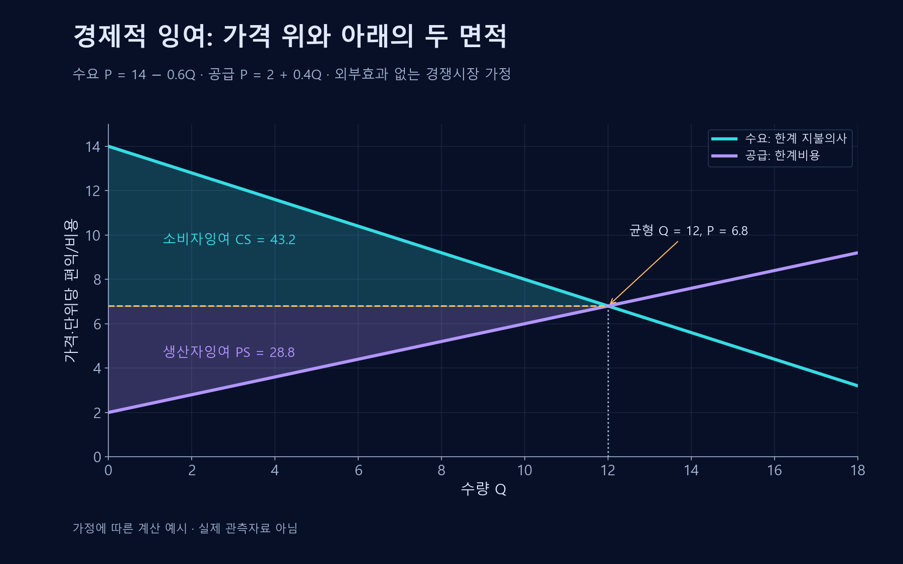

# 경제적 잉여

지불의사와 기회비용의 차이로 거래에서 생기는 이득을 분석하는 도구.

{{틀:market-basics}}

## 소비자와 생산자의 이득
**소비자잉여**는 구매자의 지불의사와 실제 지불가격의 차이다. **생산자잉여**는 판매가격과 생산자가 공급하기 위해 부담하는 관련 기회비용의 차이다. 단순히 회계상 매출과 순이익을 뜻하지 않는다.

가상의 소비자가 상품에 최대 15를 지불할 의향이 있고 판매자의 관련 비용이 7이며 거래가격이 10이면, 소비자는 5, 생산자는 3의 잉여를 얻는다. 총잉여는 8이다.

## 가격과 가치 분배
$$TS=CS+PS$$
총잉여 $TS$는 소비자잉여 $CS$와 생산자잉여 $PS$의 합이다. 다른 조건이 같다면 가격 변화는 두 주체가 나누는 몫을 바꾸지만, 거래량이나 품질이 바뀌면 전체 잉여도 달라진다.

## 효율성과 한계
이상적인 경쟁시장에서는 서로 이익이 되는 거래가 이루어질 수 있다. 그러나 외부효과·정보격차·시장지배력이 있으면 당사자들의 계산과 사회 전체의 이득이 달라진다.

## 가치 창출과 연결
기존 잉여를 상대에게서 더 가져오는 협상과, 품질 개선·낭비 감소로 총잉여를 키우는 활동은 구분된다. 이 구분은 기업의 수익이 사회적 가치 창출과 어떤 관계에 있는지 분석할 때 유용하다.

## 총잉여에서 가격이 사라지는 이유
한 단위 거래에서 구매자의 최대 지불의사를 $V$, 실제 가격을 $P$, 판매자의 해당 단위 공급 기회비용을 $C$라 두자. 소비자잉여 $CS=V-P$, 생산자잉여 $PS=P-C$이므로 다음과 같다.

$$TS=(V-P)+(P-C)=V-C$$

가격은 두 당사자 사이의 이전이므로 합산에서 상쇄된다. 그러나 가격이 달라져 거래량·품질·탐색비용이 바뀌면 총잉여도 달라진다. 거래가 유익하려면 이 단순 예에서 $V\geq C$여야 한다.

여러 단위를 거래할 때는 각 단위의 지불의사와 공급비용 차이를 합한다. 생산자잉여는 통상 변동비용 위에 남는 몫이므로 고정비까지 차감한 경제적 이윤과는 다를 수 있다. 외부효과가 있다면 제3자의 편익·비용도 포함해야 사회적 순편익이 된다.

## 소비자잉여와 생산자잉여의 면적

수요가격 $P_D=14-0.6Q$, 공급가격 $P_S=2+0.4Q$라는 가상의 선형 곡선이다. $Q$는 거래량, $P_D$는 추가 단위의 지불의사, $P_S$는 공급에 필요한 단위 가격을 뜻한다. 두 가격이 같은 경쟁균형은 수량 12, 가격 6.8이다.

소비자잉여는 수요곡선과 가격선 사이의 면적으로 $\frac12\times12\times(14-6.8)=43.2$다. 생산자잉여는 가격선과 공급곡선 사이의 면적으로 $\frac12\times12\times(6.8-2)=28.8$이다. 합계는 72이며 외부효과·시장지배력·정보 문제를 생략한 계산이다.

## 기업 이익과 총잉여의 차이
한 단위에 구매자가 최대 120을 낼 의사가 있고 공급자의 기회비용이 70이라고 하자. 가격이 90이면 소비자잉여는 30, 생산자잉여는 20이며 합은 50이다. 가격만 105로 바뀌고 같은 거래가 계속되면 각각 15와 35가 되어 합은 여전히 50이다. 이 경우 가격은 가치의 분배를 바꾸고, 총잉여는 $120-70$으로 유지된다.[^surplus-unit]

공정 개선으로 기회비용이 60이 되면 총잉여가 60으로 늘어난다. 반면 공급 과정에서 거래 당사자 밖에 20의 환경피해가 발생하면, 개선 전의 사회적 순편익은 다른 효과가 없다고 할 때 $120-70-20=30$이다. 실제로는 가격이 바뀌면 거래량도 달라질 수 있다. 가격 변화의 효과를 볼 때는 계속되는 거래의 분배 변화와, 새로 생기거나 사라지는 거래의 효과를 나눈다.

## 관련 문서
- [[market-failure|시장실패]]
- [[shared-value|공유가치 창출]]
- [[competitive-strategy|본원적 경쟁전략]]

## 참고자료
- [IMF — 국제무역](https://www.imf.org/en/publications/fandd/issues/series/back-to-basics/trade)

[^surplus-unit]: 이 계산은 거래 한 단위의 지불의사와 기회비용을 고정한 비교다. 생산자잉여는 모든 회계비용을 뺀 기업의 순이익과 일반적으로 일치하지 않는다.
