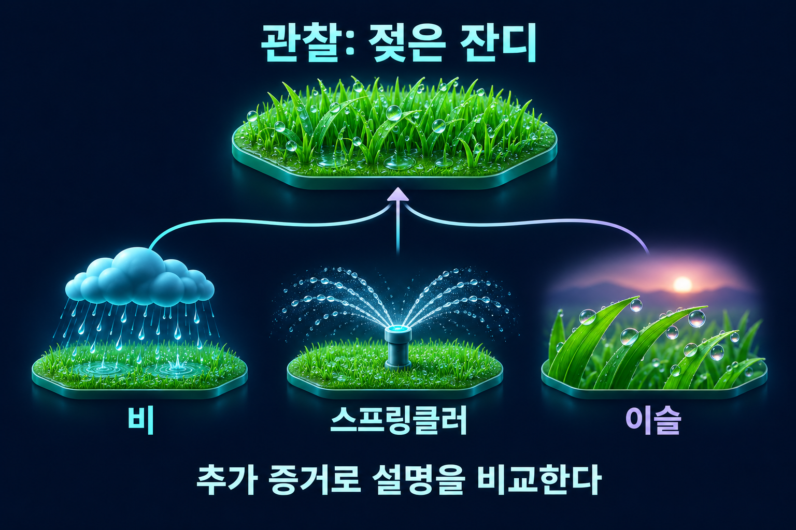

# 귀추법

관찰을 설명하는 경쟁 가설들을 비교하는 가설적 추론.

## 최선의 설명으로의 추론
**귀추법**(Abduction)은 관찰된 현상을 잘 설명하는 가설을 세우거나 경쟁 설명 가운데 더 나은 것을 선택하는 추론이다. 가추법·가설 상정논법이라고도 한다. 관찰을 새로운 설명과 연결하지만 결론을 필연적으로 보장하지 않는다.

## 젖은 잔디의 예
잔디가 젖어 있다고 하자. 비가 왔다면 그 관찰을 설명할 수 있지만, 스프링클러나 이슬도 후보가 된다.

그림은 가능한 설명을 비교하는 가상 예시다. 모든 원인을 열거하거나 각 가설의 확률을 제시한 것은 아니다. 주변 도로도 젖었는지, 급수 기록이 있는지, 시간대가 언제인지를 추가로 확인하면 후보의 상대적 설명력을 비교할 수 있다.

## 후건 긍정과 구별
“비가 오면 잔디가 젖는다. 잔디가 젖었다. 그러므로 반드시 비가 왔다”는 연역적으로 부당한 후건 긍정이다. 귀추법은 같은 관찰에서 출발하더라도 다른 원인을 검토하고 결론을 잠정적 설명으로 제시한다.

가설이 관찰을 설명할 수 있다는 이유만으로 최선이라고 단정해서도 안 된다. 사전 개연성, 다른 사실과의 정합성, 설명 범위, 독립적으로 검사할 예측을 함께 따진다.

## 발견과 검사의 구별
가설을 떠올린 과정이 독창적이라는 사실은 가설의 진실성을 보장하지 않는다. 발견 뒤에는 관찰·실험과 경쟁 가설의 비교가 필요하다. 관찰 결과에 맞추어 조건만 계속 붙이면 새 사실을 설명하거나 예측할 능력이 약해질 수 있다.

## 관련 문서
- [[inductive-reasoning|귀납논증]] · [[propositional-logic#타당한 추론과 잘못된 역추론|명제논리]]
- [[scientific-hypothesis|과학적 가설]] · [[causal-inference|인과추론]]

## 출처
- [Notion — 비판적사고와논리 5차시](https://app.notion.com/p/31a37611c79e80e9a58ed77bead45ced?pvs=204)
- [Notion — 비판적사고와논리 22차시](https://app.notion.com/p/37137611c79e8063b54cc249f479b987?pvs=204)
- [Notion — 비판적사고와논리 26차시](https://app.notion.com/p/37c37611c79e80aaa3a0f04435510d03?pvs=204)
