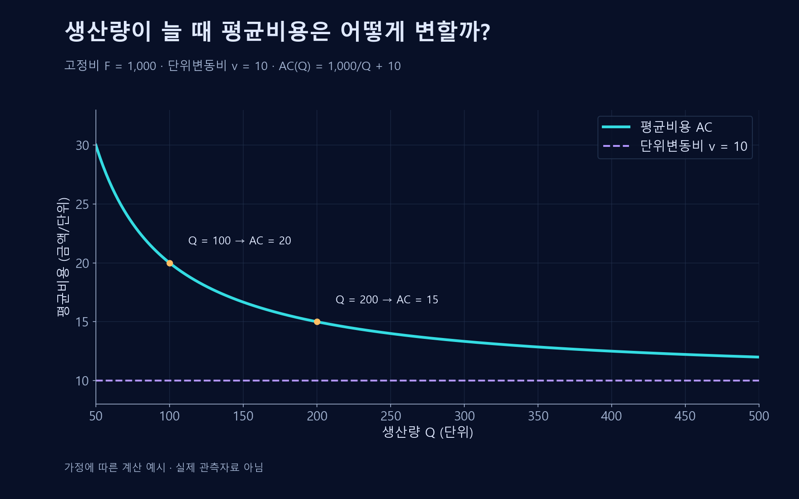

# 규모의 경제

생산규모·제품 차별화가 비용과 무역 패턴에 미치는 영향.

## 규모의 경제
**규모의 경제**(Economies of Scale)는 생산량 증가에 따라 평균비용이 낮아지는 현상이다. 고정비의 분산, 전문화, 설비의 효율적 활용 등이 원인이 될 수 있다.
$$AC(Q)=\frac{F}{Q}+v$$
고정비 $F$와 일정한 단위변동비 $v$를 가정한 단순 모형에서는 $Q$가 커질수록 고정비의 단위당 부담이 줄어든다.

## 한계와 구분
생산규모가 커지면 조정과 관리의 복잡성 때문에 규모의 불경제가 생길 수도 있다. 생산량에 따른 평균비용의 변화와, 누적 경험에 따른 학습효과, 여러 제품을 함께 만드는 범위의 경제는 서로 구분된다.

장기 평균비용 곡선의 최저점은 효율적 규모를 나타낸다. 최저 비용이 여러 산출량에서 같으면 그 구간에 처음 들어가는 양이 최소효율규모다. 시장 수요에 비해 이 규모가 크면 효율적으로 운영되는 기업이 여럿 들어서기 어려울 수 있다. 한 기업이 전체 수요를 공급하는 것이 여러 기업으로 나누어 공급하는 것보다 싼지는 관련 산출 범위의 총비용을 비교해 판단한다.

## 산업 간·산업 내 무역
산업 간 무역은 서로 다른 산업의 상품을 교환하는 것이고 산업 내 무역은 같은 산업의 차별화된 상품을 서로 수출입하는 것이다. 소비자의 다양한 선호와 규모의 경제는 비슷한 국가들 사이의 산업 내 무역을 설명하는 데 도움이 된다.

## 가상 예시
두 나라가 모두 자동차를 생산하면서도 서로 다른 차종을 수입할 수 있다. 각 기업은 일부 제품에 집중해 규모의 이익을 얻고 고객은 더 다양한 제품에 접근할 수 있다.

## 주의점
산업 분류를 얼마나 세밀하게 하느냐에 따라 측정되는 산업 내 무역의 정도가 달라질 수 있다. 규모가 크다는 사실만으로 비용우위나 시장지배가 언제나 지속되는 것도 아니다.

## 평균비용식의 유도와 변수
$Q>0$는 생산량, $F\geq0$는 해당 기간의 고정비, $v$는 일정한 단위변동비다. 총비용 $TC(Q)=F+vQ$를 생산량으로 나누면 평균비용 $AC(Q)=TC(Q)/Q=F/Q+v$가 된다. $TC$와 $F$는 금액, $AC$와 $v$는 제품 한 단위당 금액이다.

$$\frac{dAC}{dQ}=-\frac{F}{Q^2}$$

$F>0$이면 기울기가 음수이므로 이 모형의 평균비용은 감소한다. 예를 들어 $F=1{,}000$, $v=10$이면 $Q=100$에서 20, $Q=200$에서 15다. $F=0$이면 평균비용은 일정하다.

이 계산은 설비와 고정비가 주어진 범위의 분산 효과다. 경제학에서 장기 규모의 경제를 판단하려면 생산규모별로 선택 가능한 설비와 투입조합을 비교해야 하며, 단일 설비의 고정비 분산만으로 모든 규모에서 비용이 계속 하락한다고 결론내릴 수 없다.[^scale]

## 평균비용을 그래프로 보기

생산량이 100에서 200으로 늘면 평균비용은 20에서 15로 낮아진다. 곡선은 단위변동비 10에 위에서 가까워진다. 고정비와 단위변동비가 달라지는 규모까지 이 모형을 연장하지 않는다.

## 관련 문서
- [[comparative-advantage|비교우위]]
- [[platform-network-effects|플랫폼]] · [[network-effects|네트워크 효과]]
- [[competitive-strategy|본원적 경쟁전략]]
- [[production-costs|생산비용]]
- [[monopoly|독점]]

## 참고자료
- [WTO — 국제무역의 이익](https://www.wto.org/english/thewto_e/whatis_e/tif_e/fact3_e.htm)

[^scale]: 단기에는 고정 투입이 있지만 장기에는 설비 자체도 조정할 수 있다. 단기 평균비용의 하락 구간과 장기 평균비용의 하락은 관련되지만 같은 비교는 아니다.
