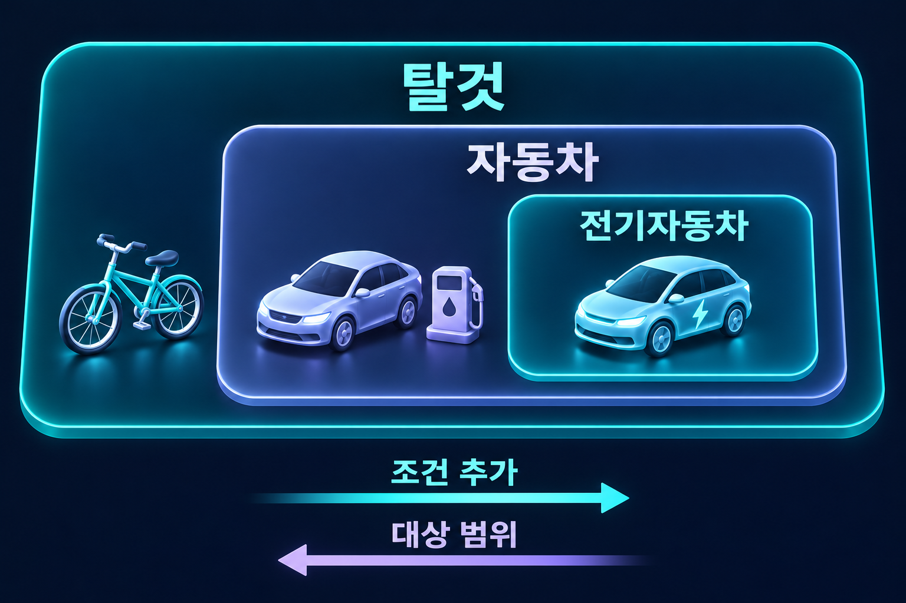

# 내포와 외연

개념의 적용 조건과 그 조건을 만족하는 대상 집합의 관계.

## 조건과 대상
**내포**(Intension)는 개념이 적용되는 데 필요한 속성이나 조건이고, **외연**(Extension)은 그 개념이 적용되는 대상들의 집합이다. ‘전기자동차’의 조건을 설명하는 것과 실제 전기자동차들의 범위를 나열하는 것은 다른 일이다.

## 조건을 추가하면
같은 논의 영역에서 기존 조건을 유지하면서 조건을 더하면 그 조건을 만족하는 대상 범위는 넓어질 수 없다. 탈것에 자동차라는 조건을 더하고 다시 전기 구동 조건을 더하면 외연은 포함관계를 이룬다.

그림의 자전거·일반 자동차·전기자동차는 각각을 설명하는 사례다. 각 집합의 모든 종류나 실제 개체 수를 나타내지 않는다.

$$\mathrm{Ext}(\text{전기자동차})\subseteq\mathrm{Ext}(\text{자동차})\subseteq\mathrm{Ext}(\text{탈것})$$

$\mathrm{Ext}$는 외연을 뜻한다. 추가한 조건을 모든 기존 대상이 이미 만족한다면 범위가 그대로일 수도 있으므로, 조건 수가 늘 때마다 외연이 반드시 엄격하게 작아진다고 말할 수는 없다.

## 함의와 포함의 방향
어떤 것이 전기자동차라면 자동차라는 결론이 따라온다. 따라서 전기자동차임은 자동차임을 함의하지만, 외연에서는 전기자동차 집합이 자동차 집합에 포함된다. 더 구체적인 개념이 더 넓은 외연을 갖는다고 뒤집어 읽지 않아야 한다.

이 포함관계는 개념이 실제로 어떤 조건을 포함하는지에 달려 있다. 관련 없는 두 단어의 내포와 외연을 단순히 ‘크다/작다’로 비교할 수 있는 것은 아니다.

## 외연이 같아도 뜻은 다를 수 있다
특정 상황에서 같은 대상들을 가리킨다는 사실만으로 두 표현의 의미까지 같아지는 것은 아니다. 반대로 상상 속 동물을 정의할 수 있어도 실제 논의 영역에서 그 외연은 비어 있을 수 있다. 정의를 제시하는 일과 대상의 존재를 입증하는 일은 구별한다.

## 관련 문서
- [[categorical-proposition|정언명제]] · [[necessary-sufficient|필요조건과 충분조건]]
- [[ambiguity-vagueness|애매성과 모호성]]

## 출처
- [Notion — 비판적사고와논리 6차시](https://app.notion.com/p/32b37611c79e8052bfe4e8252e8deddc?pvs=204)
- [Notion — 비판적사고와논리 24차시](https://app.notion.com/p/37137611c79e8072902fd171dd7a910f?pvs=204)
