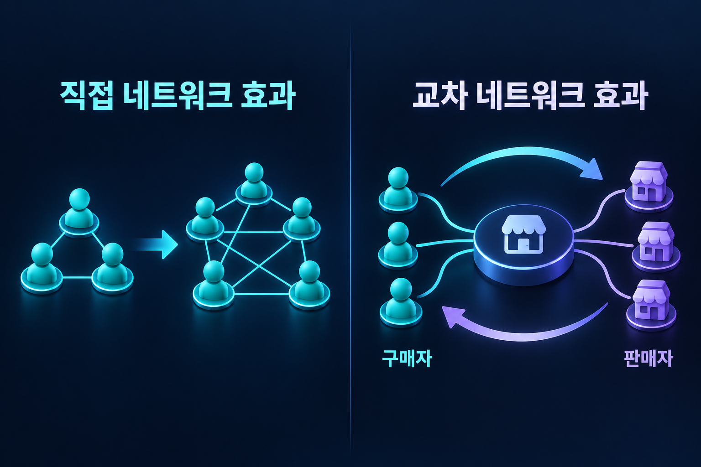

# 네트워크 효과

여러 이용자 집단의 상호작용과 규모가 서비스의 가치에 영향을 주는 구조.

## 직접·간접 네트워크 효과

직접 효과는 같은 집단의 이용자 수가 서비스 가치에 영향을 주는 경우다. 간접 또는 교차 효과는 한 집단의 규모가 다른 집단의 가치에 영향을 주는 경우다. 구매자가 늘어 판매자가 참여하고 상품이 늘어 다시 구매자가 늘어나는 과정이 예가 된다.

*왼쪽은 같은 집단 안의 연결, 오른쪽은 서로 다른 집단 사이의 효과를 보여준다. 연결 수가 늘었다는 사실만으로 가치가 같은 비율로 증가하는 것은 아니다.*

## 규모의 경제와 구분

네트워크 효과는 주로 수요 측의 가치 변화이고, 규모의 경제는 생산량 증가에 따른 비용 변화다. 둘이 함께 나타날 수 있지만 같은 개념은 아니다.

## 한계와 부정적 효과

이용자가 늘면 혼잡·스팸·사기·선택 피로가 증가할 수도 있다. 이용자의 수만이 아니라 참여자의 질, 매칭의 적합성, 신뢰가 중요하다. 여러 플랫폼을 동시에 쓰는 멀티호밍과 전환 비용도 경쟁을 바꾼다.

## 초기 참여와 품질의 문제
거래 플랫폼은 구매자가 적으면 판매자의 참여 유인이 작고, 상품이 적으면 구매자가 오지 않는 초기 문제를 겪을 수 있다. 한쪽 참여비용을 낮추거나 특정 지역·품목에 집중해 유효한 매칭을 먼저 늘리는 방식이 가능하다.

이용자 수 자체보다 실제로 연결될 수 있는 상대의 수와 질이 중요하다. 전국의 가입자가 많아도 주변에 운전자가 없다면 해당 지역의 승객 가치는 낮다. 또한 전환 비용 때문에 떠나기 어려운 현상은 다른 이용자가 주는 편익과 구별해야 한다.[^network-lockin]

## 관련 문서

- [[platform-network-effects|플랫폼]]
- [[economies-of-scale|규모의 경제]]
- [[information-systems|정보시스템]]
- [[business-ethics#기업지배구조|기업지배구조]]

## 참고자료

- [OECD — 디지털 플랫폼과 네트워크 효과](https://www.oecd.org/en/publications/oecd-digital-economy-outlook-2020_bb167041-en/full-report/component-13.html)

[^network-lockin]: 데이터 이전의 어려움과 계약 해지 비용은 이용자 수가 늘지 않아도 발생할 수 있다. 네트워크 효과와 전환 비용은 서로 강화할 수 있지만 같은 개념은 아니다.
