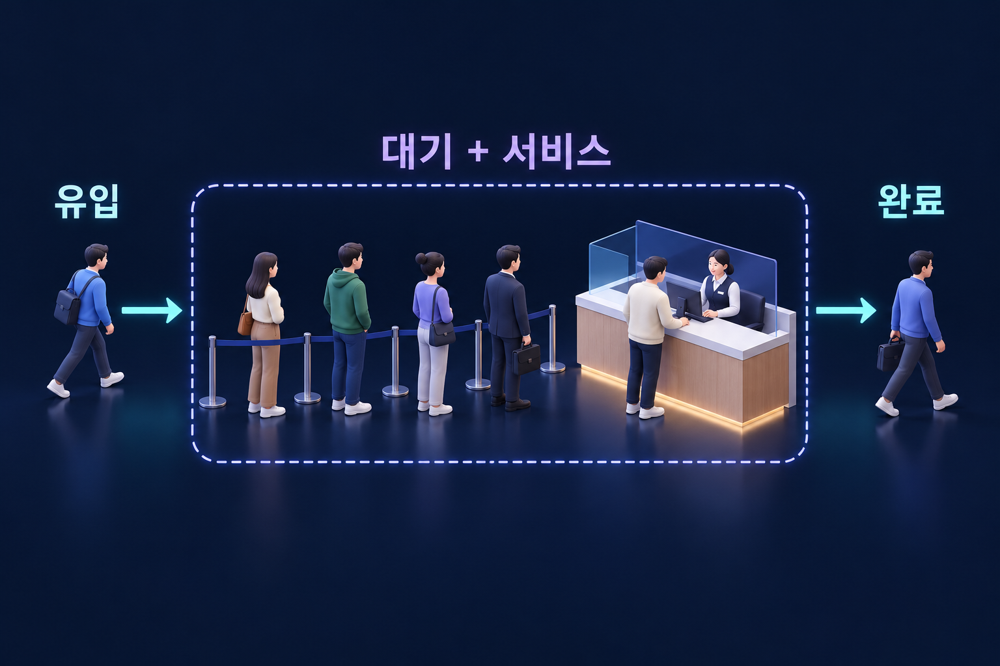

# 대기행렬

유입률·체류시간·시스템 안의 평균 수량을 연결하는 분석 틀.

## 대기행렬
**대기행렬**(Queue)은 요청이 즉시 처리되지 못하고 기다리는 구조다. 고객 줄, 상담 요청, 생산 중인 작업, 소프트웨어 처리 요청 등에서 나타난다. 도착과 처리 시간이 불규칙하면 평균 처리능력이 평균 수요보다 커도 대기가 생길 수 있다.

*점선 안에는 대기와 서비스가 모두 포함된다. 이 범위의 평균 수량을 계산한다면 체류시간도 대기시간과 서비스시간을 함께 포함해야 한다. 그림의 사람 수는 장기 평균을 뜻하지 않는다.*

## 리틀의 법칙
장기적으로 안정된 시스템에서 일관된 경계를 사용하면 다음 관계를 적용할 수 있다.
$$L=\lambda W$$
$L$은 시스템 안의 평균 수량, $\lambda$는 단위시간당 평균 처리율, $W$는 평균 체류시간이다. 대기열만 볼지 서비스 중인 수량까지 포함할지 범위를 맞춰야 한다.

## 계산 예시
가상의 서비스가 평균 시간당 12건을 처리하고 평균 체류시간이 15분이면 $L=12\times0.25=3$건이다. 시간의 단위를 맞추지 않으면 결과가 틀린다.

## 가동률과 변동성
처리능력을 한계까지 사용하면 수요·작업시간의 작은 변동도 긴 대기를 만들 수 있다. 단순히 모든 직원이 쉬지 않게 하는 목표가 고객의 총 체류시간을 개선하는 목표와 충돌할 수 있다.

## 관리 방법
병목 개선, 도착 분산, 불필요한 재작업 감소, 처리시간 변동 축소 등을 검토한다. 평균만이 아니라 긴 대기시간의 빈도와 우선순위 규칙의 공정성도 살펴야 한다.

## 리틀의 법칙을 면적으로 이해하기
빈 시스템에서 시작해 다시 비는 관찰구간을 생각하자. 관찰구간에 $n>0$건이 처리되었다고 하고 관찰길이를 $T$, 시각 $t$의 시스템 안 수량을 $N(t)$, 구간 안에 들어와 나간 건수를 $n$, 각 건의 체류시간을 $W_i$라 한다. 수량 그래프 아래 면적은 각 건이 머문 시간의 합과 같다.

$$\int_0^T N(t)\,dt=\sum_{i=1}^{n}W_i$$

양변을 $T$로 나누고 $L_T$를 시간평균 수량, $\lambda_T=n/T$를 평균 처리율, $\bar W_T$를 건당 평균 체류시간으로 두면 다음을 얻는다.

$$L_T=\frac{1}{T}\sum_i W_i=\frac{n}{T}\frac{1}{n}\sum_i W_i=\lambda_T\bar W_T$$

일반 관찰구간에서는 시작·끝에 걸친 건의 시간을 보정해야 한다. 유한한 장기 평균이 존재하고 경계 보정의 시간당 영향이 사라지면 $L=\lambda W$가 된다. 도착이 반드시 포아송이거나 처리시간이 지수분포일 필요는 없다.[^little-proof]

## 관련 문서
- [[operations-management|운영관리]]
- [[service-operations|서비스 운영관리]]
- [[phantom-stockouts|가상 품절]]

## 참고자료
- [MIT — 대기행렬과 리틀의 법칙](https://web.mit.edu/1.041/www/lectures/L8-queuing-models-2026sp.pdf)

[^little-proof]: [Little — Little’s Law as Viewed on Its 50th Anniversary (2011)](https://people.cs.umass.edu/~emery/classes/cmpsci691st/readings/OS/Littles-Law-50-Years-Later.pdf). 위 설명은 면적 항등식에 기초한 유도다. 유입이 유출을 계속 초과해 수량이 무한히 쌓이는 상태에는 유한한 안정 평균을 전제한 식을 그대로 적용할 수 없다.
