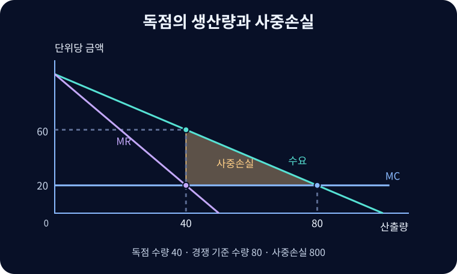

# 독점

관련 시장에 판매자가 하나이고 진입장벽이나 가까운 대체재의 부족으로 가격과 생산량에 영향을 미치는 시장 구조.

## 시장과 진입장벽

시장 범위는 어떤 상품과 지역에 실질적인 대체재가 있는지에 달려 있다. 전용망처럼 초기 고정비가 매우 큰 사업, 중요한 투입의 통제, 특허와 법적 독점권은 진입장벽의 원인이 될 수 있다. 특허의 권리 범위와 시장의 대체재는 별개다. 진입장벽이 있어도 수요가 적거나 비용이 높으면 독점기업이 손실을 낼 수 있다.

## 수요곡선과 한계수입

$$TR(Q)=P(Q)Q,\qquad MR=P(Q)+Q\frac{dP}{dQ}$$

$P(Q)$는 수량 $Q$를 팔 수 있는 단일가격이다. 첫 항은 한 단위 추가 판매로 얻는 수량 효과, 둘째 항은 모든 기존 판매분에 더 낮은 가격을 적용하는 가격 효과다. $Q>0$이고 역수요의 기울기가 음수이면 $MR<P$다. 직선 역수요 $P=a-bQ$에서는 $MR=a-2bQ$여서 절편이 같고 기울기의 절댓값은 두 배다. 평균수입은 여전히 $P$다.

수요의 가격탄력성 절댓값을 $\eta$라 하면 미분 가능한 수요에서 다음과 같이 쓸 수 있다.

$$MR=P\left(1-\frac{1}{\eta}\right),\qquad
\frac{P-MC}{P}=\frac{1}{\eta}\quad\text{(내부 최적점)}$$

첫 식은 $Q(dP/dQ)=-P/\eta$를 대입한 것이다. 둘째 식은 $MR=MC$에서 나온 상대 마크업이다. $P>0$, $MC>0$인 내부 최적점에서는 $MR>0$이어야 하므로 수요의 탄력적 구간에서 생산한다. 시장지배력이 있어도 가격을 올릴수록 수량이 감소하는 제약이 있다.

## 산출량, 가격과 후생

역수요 $P=100-Q$, 한계비용 $MC=20$을 가정한다. $MR=100-2Q=20$에서 독점 수량은 40, 수요곡선에서 읽은 가격은 60이다. 같은 한계비용의 경쟁 기준점에서는 $P=MC=20$으로 수량이 80이다. 시장에서 포기된 40단위에 대해 수요의 한계편익이 비용보다 높았으므로 사중손실은 $\tfrac12(80-40)(60-20)=800$이다.[^welfare]

독점의 소비자잉여는 $\tfrac12(100-60)40=800$이다. 고정비를 생략하면 생산자잉여와 이윤은 $(60-20)40=1{,}600$이다. 경쟁의 소비자잉여는 3,200이다. 소비자잉여 감소분 2,400 중 1,600은 생산자에게 이전되고, 800은 거래가 사라져 누구에게도 돌아가지 않는다. 일반적으로 경쟁에서도 공급곡선이 우상향하면 생산자잉여가 양수일 수 있다.

## 자연독점과 규제

자연독점은 관련 수요 범위에서 한 기업이 시장 수량을 모두 공급하는 총비용이 여러 기업으로 나누는 비용보다 낮은 경우다. 고정망 비용과 낮은 한계비용을 가진 사업이 대표적인 예다.

| 접근 | 작동 방식과 쟁점 |
| --- | --- |
| 한계비용 가격 | $P=MC$로 배분 효율을 높일 수 있다. $ATC>MC$라면 사용료만으로 총비용을 회수할 수 없어 보조 또는 별도 고정요금 등이 필요하다. |
| 평균비용 가격 | $P=ATC$에서 경제적 이윤이 0이다. $P>MC$면 거래량은 효율 기준보다 작을 수 있고 비용 절감 유인도 검토한다. |
| 공공소유 또는 위탁 | 공급 범위·투자·가격을 제도적으로 정할 수 있다. 정보 비대칭, 비용 통제와 재정 부담은 여전히 남는다. |
| 개입하지 않음 | 대체재·잠재 진입 및 혁신이 지배력을 제한하거나 개입 비용이 클 때 검토할 수 있다. |

진입장벽 완화나 경쟁법 집행이 적절한 경우와 자연독점의 요금규제가 필요한 경우를 구분한다. 제품과 지역의 시장 범위, 설비 중복 비용, 서비스 품질과 장기 투자 반응이 판단을 바꾼다.

## 독립적인 공급곡선이 어려운 이유

완전경쟁 기업은 가격을 외부에서 받아 각 가격별 생산량을 정한다. 독점기업은 수요의 수준과 기울기에 따라 한계수입을 계산한다. 수요가 달라지면 같은 가격에서도 다른 최적 수량이 나올 수 있으므로 한계비용만으로 독립적인 가격·수량 공급곡선을 정할 수 없다. 독점적 경쟁에서도 각 기업이 직면하는 수요의 형태가 생산 결정에 들어간다.

## 관련 문서

- [[perfect-competition|완전경쟁]]
- [[monopolistic-competition|독점적 경쟁]]
- [[price-discrimination|가격차별]]
- [[market-concentration|시장집중도]]
- [[economic-surplus|경제적 잉여]]

## 참고자료

- [OpenStax — 독점기업의 가격과 생산량 결정](https://openstax.org/books/principles-economics-3e/pages/9-2-how-a-profit-maximizing-monopoly-chooses-output-and-price)
- [OpenStax — 자연독점의 규제](https://openstax.org/books/principles-economics-3e/pages/11-3-regulating-natural-monopolies)

[^welfare]: 시장 전체에 동일한 수요·한계비용이 적용되며 외부효과와 수량 제한은 생략했다. 고정비가 두 체제에서 같으면 차이 계산에서 상쇄되지만, 진입에 따른 고정비 중복이나 장기 기술 변화가 있다면 후생 비교가 달라질 수 있다.
