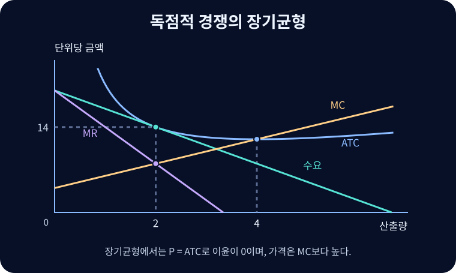

# 독점적 경쟁

많은 기업이 서로 대체할 수 있는 차별화된 상품을 팔고 장기에는 진입과 퇴출이 가능한 시장 구조.

{{틀:market-structure}}

## 제품차별화와 단기 선택

동네 카페는 음료가 비슷해도 위치·맛·분위기·서비스·브랜드가 다르다. 가까운 대체재가 있어도 일부 고객은 특정 가게를 선호하므로 기업의 수요곡선은 우하향한다. [[monopoly|독점]]과 마찬가지로 기업은 $MR=MC$인 내부 산출량을 고르고 그 수량에서 수요곡선의 가격을 읽는다. $MR$은 한계수입, $MC$는 한계비용이다. 가격 $P$와 한계비용의 차이 $P-MC$가 단위당 절대 마크업이다. 단기에 수요가 강하면 $P>ATC$로 이윤을 얻을 수 있고, 반대면 손실이 발생한다.

## 진입과 장기 접점

양의 경제적 이윤이 신규 기업을 끌어들이면 기존 기업의 수요가 줄거나 더 탄력적으로 바뀐다. 손실이 지속되면 일부 기업이 나가 남은 기업의 수요를 높일 수 있다. 자유 진입과 대칭적인 표준 장기균형에서 평균총비용 $ATC$와 기업 수요곡선이 산출점에서 접한다. 따라서 $P=ATC$이고 이윤은 0이지만, 가격은 한계비용보다 높다.

$$\pi=(P-ATC)Q=0,\qquad P=ATC>MC$$

기업은 $MR=MC$를 만족한다. 우하향 수요에서 $P>MR$이므로 $P>MC$가 따라온다. 또한 $\frac{dATC}{dQ}=(MC-ATC)/Q<0$이므로 산출점은 U자형 $ATC$의 최소점 왼쪽이다. 이를 **초과설비**라고 부른다. 동일 상품을 대량으로 공급할 때의 비용 절감과 여러 상품을 고를 수 있는 소비자 편익을 함께 비교해야 한다.[^variety] 이 구조에서도 한계비용만으로 독립적인 공급곡선을 만들 수 없다.

그림에서 역수요는 $P=20-3Q$, 총비용은 $TC=16+4Q+Q^2$다. $MR=20-6Q$와 $MC=4+2Q$를 같게 놓으면 $Q=2$다. 이때 가격은 14이고 $ATC=16/2+4+2=14$여서 이윤은 0이다. $MC=8$이므로 단위당 마크업은 6이다. $ATC$가 최소인 $Q=4$는 시장에서 실제로 고른 수량보다 크다.

## 광고와 브랜드

정보 광고는 가격·품질·성분·위치를 알리고 탐색비용을 낮춘다. 설득 광고는 제품에 대한 선호나 인지도를 바꿔 브랜드 충성도를 높일 수 있다. 하나의 광고가 두 역할을 함께 할 수 있다. 광고로 늘어난 수요와 브랜드 유지 비용을 기업 관점에서 비교하고, 소비자 관점에서는 정보의 정확성과 선택 가능성이 어떻게 바뀌는지 살핀다.

## 관련 문서

- [[perfect-competition|완전경쟁]]
- [[monopoly|독점]]
- [[oligopoly|과점]]
- [[brand-loyalty|브랜드 충성도]]

## 참고자료

- [OpenStax — 독점적 경쟁과 광고](https://openstax.org/books/principles-economics-3e/pages/10-1-monopolistic-competition)

[^variety]: 장기 무이윤은 표준 진입 모형의 결과다. 입지의 희소성, 독점적 브랜드 자산, 고정 진입비와 기업 간 비대칭이 있으면 관찰되는 수익률과 가격 관계가 달라질 수 있다.
