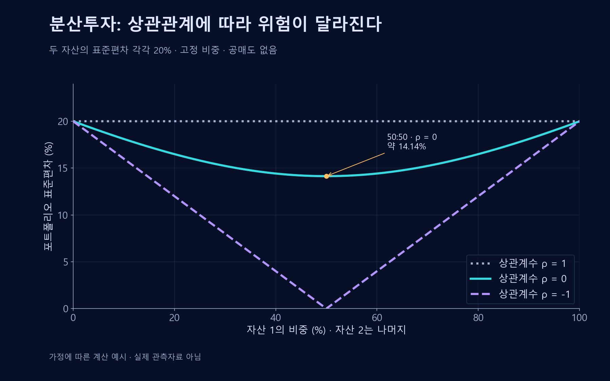

# 분산 투자

서로 완전히 같은 방향으로 움직이지 않는 자산을 함께 보유하면 특정 자산의 불리한 결과가 전체에 미치는 영향을 줄일 수 있다.

## 분산투자의 원리

두 자산의 경우 공분산도 포트폴리오 위험에 영향을 준다.
$$\operatorname{Var}(R_p)=w_1^2\sigma_1^2+w_2^2\sigma_2^2+2w_1w_2\operatorname{Cov}(R_1,R_2)$$

## 한계

종목 수가 많아도 같은 산업·국가·위험요인에 몰려 있으면 실질적으로 집중되어 있을 수 있다. 시장 전체의 위험은 분산만으로 없어지지 않으며 위기에는 상관관계가 달라질 수 있다.

## 수식의 변수와 유도
$R_1,R_2$는 같은 기간의 자산 수익률, $w_1,w_2$는 투자 비중이며 여기서는 $w_1+w_2=1$인 고정 비중을 가정한다. 포트폴리오 수익률은 $R_p=w_1R_1+w_2R_2$다. $\sigma_i^2=\operatorname{Var}(R_i)$는 각 자산 수익률의 분산, $\operatorname{Cov}(R_1,R_2)$는 공분산이다. $i$는 자산의 번호이고, $\sigma_i$는 표준편차, $E$는 기대값을 뜻한다.

편차를 제곱하면 교차항이 생긴다. 기대값을 취하고 공분산의 정의를 적용하면 본문의 분산식을 얻는다.

$$\operatorname{Var}(R_p)=E\left[\left\{w_1(R_1-E[R_1])+w_2(R_2-E[R_2])\right\}^2\right]$$

## 상관관계가 위험에 미치는 영향
표준편차가 양수일 때 상관계수 $\rho=\operatorname{Cov}(R_1,R_2)/(\sigma_1\sigma_2)$를 쓰면 공분산은 $\rho\sigma_1\sigma_2$다. 두 자산의 표준편차가 모두 20%, 비중이 각각 절반이라고 가정하자.

| 상관계수 | 포트폴리오 분산 | 표준편차 |
| --- | --- | --- |
| 1 | 0.04 | 20% |
| 0 | 0.02 | 약 14.14% |
| −1 | 0 | 0% |

마지막 행은 완전한 음의 상관과 같은 변동성이라는 극단적인 가정이다. 현실에서 이런 상관이 유지되거나 모든 손실 위험이 제거된다고 기대할 수는 없다. 변동성 외의 유동성·신용·물가위험도 별도로 평가한다.[^div-risk]

## 비중과 상관관계를 함께 바꾸기

가로축은 자산 1의 비중이고 자산 2는 나머지다. 상관계수가 0인 50:50 조합의 표준편차는 약 14.14%다. 상관계수가 −1인 경우의 0%는 완전한 음의 상관·동일 변동성이라는 극단적 가정의 결과이며, 실제 위험 제거를 보장하지 않는다.

## 관련 문서

- [[risk-return|투자]]
- [[compound-interest|화폐의 시간가치]]
- [[efficient-markets|효율적 시장 가설]]
- [[insurance-risk-pooling|보험]]

## 참고자료

- [FCA — 위험과 수익](https://www.fca.org.uk/investsmart/risk-returns)
- [SEC Investor.gov — 자산배분과 분산투자](https://www.investor.gov/introduction-investing/getting-started/asset-allocation)

[^div-risk]: [SEC Investor.gov — 자산배분과 분산투자](https://www.investor.gov/introduction-investing/getting-started/asset-allocation)는 자산·산업 간 분산과 시장 하락에서의 한계를 설명한다. 표는 분산 항등식을 설명하기 위한 가정 계산이다.
