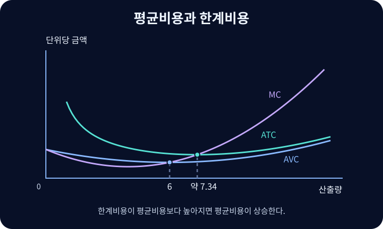

# 생산비용

기업이 산출량을 선택할 때 부담하는 자원의 기회비용과 총비용·평균비용·한계비용의 관계.

{{틀:market-structure}}

{{틀:costs-and-profit}}

## 고정비와 가변비

$$TC(Q)=TFC+TVC(Q)$$

$Q$는 생산량, $TC$는 총비용, $TFC$는 해당 기간의 총고정비용, $TVC$는 총가변비용이다. 단기에 이미 계약한 임대료는 생산을 0으로 줄여도 발생할 수 있다. 원재료나 사용량에 비례하는 전력은 가변비가 될 수 있다. 같은 인건비도 단기 고용계약과 장기 인력계획에서 성격이 다를 수 있다. 경제적 비용에는 지급한 비용과 함께 자기 소유 설비, 자본, 경영자 시간의 기회비용을 포함한다.

$$ATC=\frac{TC}{Q}=AFC+AVC,\qquad AFC=\frac{TFC}{Q},\qquad AVC=\frac{TVC}{Q}$$

$Q>0$에서 각 평균은 한 단위당 비용이다. 고정비가 양수이면 $AFC$는 생산량이 늘수록 하락한다. 한계비용 $MC$는 $\Delta TC/\Delta Q$로 계산하는 추가 단위의 비용이다. 연속 모형에서는 $dTC/dQ=dTVC/dQ$다. 같은 설비와 고정비가 유지되는 구간에서 생산량에 반응하지 않는 고정비는 한계비용에 들어가지 않는다.

## 평균과 한계의 관계

$$\frac{dATC}{dQ}=\frac{MC-ATC}{Q},\qquad
\frac{dAVC}{dQ}=\frac{MC-AVC}{Q}$$

$ATC=TC/Q$를 미분하면 $(Q\,MC-TC)/Q^2$이므로 첫 식이 나온다. 새 단위의 비용이 지금까지의 평균보다 낮으면 평균을 끌어내리고, 높으면 끌어올린다. $MC$가 아래에서 위로 $ATC$ 또는 $AVC$를 가로지르면 각각의 최소점이다. 일정 설비에서 초기 전문화나 가동률 상승으로 단위비용이 낮아지다가 한계생산 체감, 병목과 초과근무로 추가 비용이 커지면 U자형이 나타날 수 있다. 모든 기업에 같은 곡선 형태를 가정할 필요는 없다.

그림은 $TFC=36$, $TVC=20Q-3Q^2+0.25Q^3$인 가상 기업이다. $AVC=20-3Q+0.25Q^2$이므로 $Q=6$에서 최저값 11을 갖는다. $ATC=36/Q+AVC$의 최저점에서는 $MC=ATC$이므로 $0.5Q^3-3Q^2-36=0$이다. 이 식의 양의 해는 약 7.34다. $Q=6$에서도 단위당 고정비는 계속 하락 중이므로 $AVC$보다 뒤에서 $ATC$의 최저점에 도달한다.

## 단기와 장기

단기에는 설비 등 일부 투입이 고정된다. 장기에는 설비 규모까지 선택할 수 있으며 장기 평균비용은 각 산출량을 낼 수 있는 설비와 투입조합 중 최소 평균비용이다. 장기 평균비용이 하락·일정·상승하는 구간은 각각 규모의 경제·일정한 장기 단위비용·규모의 불경제다. 규모수익은 모든 투입을 같은 비율로 늘릴 때 산출이 어떻게 변하는지 묻는 생산기술 개념이다. 투입가격이 일정한 표준 환경에서는 규모수익과 장기 평균비용이 연결되지만, 투입가격이 산출 규모에 따라 바뀌면 비용 효과를 따로 본다.[^scale]

## 생산 여부와 원가 기준

단기 생산 여부는 가격이 평균가변비용을 덮는지, 장기 존속은 전체 경제적 비용을 회수할 수 있는지에 좌우된다. 회계상 제품 원가, [[cost-volume-profit|공헌이익]]의 변동원가, 경제학의 기회비용은 목적에 따라 포함 항목이 달라진다. 예를 들어 자기 건물의 임대 기회비용은 현금 지출이 없어도 경제적 비용이다.

## 관련 문서

- [[economies-of-scale|규모의 경제]]
- [[opportunity-cost|기회비용]]
- [[perfect-competition|완전경쟁]]
- [[cost-volume-profit|원가·조업도·이익 분석]]

## 참고자료

- [OpenStax — 단기 생산비용](https://openstax.org/books/principles-economics-3e/pages/7-3-costs-in-the-short-run)
- [OpenStax — 장기 생산비용](https://openstax.org/books/principles-economics-3e/pages/7-5-costs-in-the-long-run)

[^scale]: 장기 평균비용의 최저점을 이루는 산출량이 하나일 수도, 평평한 구간일 수도 있다. 후자의 경우 그 최저비용을 처음 달성하는 산출량을 최소효율규모라고 부른다.
