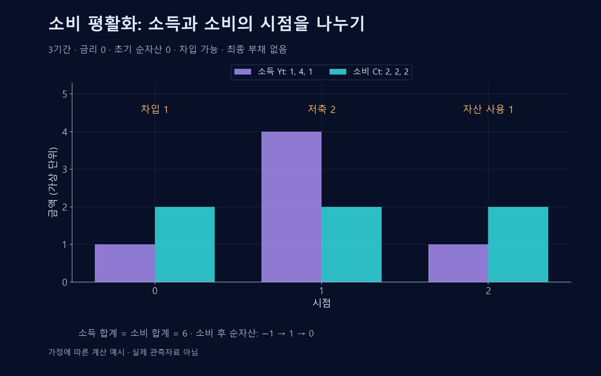

# 소비 평활화

소득이 변해도 소비의 급격한 변동을 줄이려는 개인의 선택.

## 핵심 개념
**소비 평활화**(Consumption Smoothing)는 현재 소득에 맞춰 소비를 그대로 오르내리게 하기보다 저축·차입·자산 활용으로 시간에 걸친 소비를 조정하는 것을 뜻한다. 소득이 완벽하게 일정해야 한다는 뜻은 아니다.

## 생애주기 관점
청년기에 소득이 낮고 근로기에 높으며 은퇴 후 낮아지는 전형적인 경로를 생각할 수 있다. 개인은 현재 소득뿐 아니라 미래 소득과 자산을 예상해 현재의 소비·저축을 선택한다.

기간 간 예산제약은 단순하게 다음처럼 표현할 수 있다.
$$\sum_{t=0}^{T}\frac{C_t}{(1+r)^t}\leq A_0+\sum_{t=0}^{T}\frac{Y_t}{(1+r)^t}$$
소비의 현재가치는 초기 자산과 소득의 현재가치에 제약된다. 실제 금리와 불확실성은 시점에 따라 달라질 수 있다.

## 제약과 위험
미래 소득이 높을 것으로 예상해도 대출에 접근하지 못할 수 있다. 실업·질병·기대수명·금리의 불확실성 때문에 예비적 저축이 중요해진다.

## 해석상의 주의
이 이론은 모든 개인이 완벽한 미래를 알고 계획한다는 사실 주장이 아니다. 관찰되는 저축과 소비를 설명하는 모형이며, 개인의 실제 선택에는 가족지원·제도·선호·행동편향 등이 함께 작용한다.

## 예산제약의 기호와 유도
$t$는 시점, $T$는 마지막 시점, $C_t$는 해당 시점의 소비, $Y_t$는 해당 시점에 사용할 수 있는 순소득, $r>-1$은 일정한 기간당 이자율이다. $A_0$는 시점 0의 소비 이전에 보유한 순자산이다. 금액은 모두 같은 통화와 명목·실질 기준을 사용한다.

시점 $t$ 소비 이전의 자산을 $A_t$라 하고 남은 자산에 이자가 붙는다고 정하면 $A_{t+1}=(1+r)(A_t+Y_t-C_t)$다. 이를 $(1+r)^{t+1}$로 나누고 $t=0$부터 $T$까지 더하면 중간 자산항이 상쇄된다.

$$\sum_{t=0}^{T}\frac{C_t}{(1+r)^t}=A_0+\sum_{t=0}^{T}\frac{Y_t}{(1+r)^t}-\frac{A_{T+1}}{(1+r)^{T+1}}$$

마지막에 미상환 부채를 남기지 않는 조건 $A_{T+1}\geq0$을 두면 본문의 부등식을 얻는다. 이 제약만으로 매기 같은 소비가 최적이라는 결론은 나오지 않는다. 선호·할인·불확실성·차입제약이 소비 경로를 결정한다.[^smoothing-time]

## 세 기간의 단순 예시

금리 0, 초기 순자산 0, 차입 가능을 가정하면 첫 기간에 1을 빌리고 다음 기간의 여유 소득 2 중 1로 상환한 뒤 1을 저축할 수 있다. 마지막 기간에는 그 자산 1을 써서 소비 2를 유지한다. 소비 후 순자산은 −1, 1, 0이고 총소득과 총소비는 모두 6이다. 이 경로가 누구에게나 가능하거나 최적이라는 뜻은 아니다.

## 관련 문서
- [[finance|금융]]
- [[compound-interest|화폐의 시간가치]]
- [[insurance-risk-pooling|보험]]

## 참고자료
- [세인트루이스 연방준비은행 — 생애소득과 소비 평활화](https://www.stlouisfed.org/publications/page-one-economics/2014/11/01/smoothing-the-path-balancing-debt-income-and-saving-for-the-future)

[^smoothing-time]: 위 유도는 소비와 소득이 각 시점에 발생한 뒤 이자가 붙는 시간 규약을 사용한다. 연말소득·연초소비처럼 지급 시점이 달라지면 할인 지수도 그 규약에 맞춰 바꿔야 한다.
