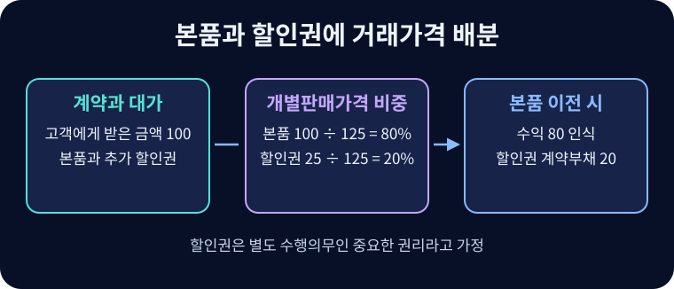

# 수익 인식

고객에게 약속한 재화나 용역의 통제가 이전되는 시점과 받을 대가에 따라 매출을 기록하는 절차.

## 고객 계약의 다섯 단계

IFRS 15의 원칙은 기업이 고객에게 재화·용역을 이전하는 모습을 그 대가로 받을 권리를 갖게 될 것으로 예상하는 금액으로 나타내는 것이다.

1. **계약을 식별한다.** 당사자의 승인과 이행 의사, 식별 가능한 권리·지급조건, 상업적 실질과 회수 가능성을 살핀다.
2. **수행의무를 식별한다.** 고객이 자체적으로 또는 구할 수 있는 다른 자원과 함께 효익을 얻을 수 있고 계약 내 다른 약속과 구별되는 재화·용역을 분리한다.
3. **거래가격을 산정한다.** 고정·변동대가, 유의적인 금융요소, 비현금 대가, 고객에게 지급할 대가 등을 고려한다.
4. **거래가격을 배분한다.** 원칙적으로 계약 개시일의 상대적 개별판매가격을 사용한다. 관찰값이 없으면 시장, 원가와 마진 등을 이용해 추정한다.
5. **수행의무를 이행할 때 수익을 인식한다.** 고객이 효익을 동시에 소비하거나, 고객이 통제하는 자산을 만들거나, 대체 용도가 없고 현재까지 이행분의 지급을 청구할 권리가 있으면 기간에 걸쳐 인식할 수 있다. 그 밖에는 통제를 이전하는 한 시점에 인식한다.

기간에 걸쳐 이행할 때는 진행률을 합리적으로 측정한다. 특정 시점에 이전하는 경우 고객의 물리적 점유, 현재 지급의무, 소유권, 위험과 보상, 검수 등을 단서로 본다.

## 매출채권·계약자산·계약부채

| 거래 상태 | 기록 |
| --- | --- |
| 납품했고 지급기한이 오는 것 외에는 청구에 조건이 없음 | 차변 매출채권, 대변 매출 |
| 일부를 이행했으나 대가 청구에 추가 이행 조건이 남음 | 차변 계약자산, 대변 수익 |
| 현금을 먼저 받았으며 이행의무가 남음 | 차변 현금, 대변 계약부채 |
| 이후 선수 용역을 제공함 | 차변 계약부채, 대변 수익 |
| 채권을 회수함 | 차변 현금, 대변 매출채권 |

12개월 구독료 120을 먼저 받으면 최초에 계약부채 120을 기록한다. 서비스가 균등하다면 매월 10씩 부채를 줄이고 매출을 인식한다. 선결제는 자금 운용 여유를 주지만 향후 제공해야 할 서비스가 남는다.

## 할인·쿠폰·리베이트

할인·리베이트·환불·성과보너스는 변동대가가 될 수 있다. 가능한 결과의 확률가중 기댓값 또는 가장 가능성 높은 금액 중 예측에 더 적절한 방법을 쓰고, 불확실성이 해소될 때 누적 수익의 유의적 환원이 발생하지 않을 가능성이 매우 높은 범위까지만 포함한다. 고객에게 지급하는 대가는 고객으로부터 구별되는 재화·용역을 받는 부분을 제외하고 일반적으로 거래가격에서 차감한다. 공급업체 리베이트와 고객 리베이트는 거래 상대와 경제적 실질이 다르다.

고객이 계약을 맺지 않았다면 받지 못할 실질적인 추가 할인권은 별도 수행의무인 **중요한 권리**가 될 수 있다. 일반 고객도 받을 수 있는 할인은 같은 결론을 자동으로 내리지 않는다.

$$P_i=P_{\mathrm{total}}\frac{SSP_i}{\sum_j SSP_j}$$

$P_i$는 의무 $i$에 배분하는 거래가격, $P_{\mathrm{total}}$은 고객 계약의 거래가격, $SSP_i$는 개별판매가격이다. 본품 100과 할인권 25가 개별판매가격이고 받은 금액이 100이면 각각 80과 20을 배분한다. 본품 이전 시 수익 80과 계약부채 20을 기록하고, 할인권 행사에 따른 재화·용역의 이전 또는 권리 소멸 시 관련 금액을 인식한다. 할인권의 독립가격을 추정할 때는 행사 확률과 일반 할인 수준을 고려한다.

이 예에서 고객이 할인권을 쓰고 추가 대가 30을 내는 동시에 새 상품의 통제를 받으면, 차변 현금 30과 계약부채 20, 대변 수익 50으로 기록한다. 행사분에 배분했던 20을 부채에서 수익으로 옮기므로 두 거래 전체의 수익 130은 총수취액 130과 일치한다.[^allocation]

## 반품과 미사용 권리

반품 가능성이 있으면 반환되지 않을 것으로 예상하는 부분만 수익으로 인식한다. 예상 환불액은 **환불부채**, 돌려받을 상품에 대한 권리는 회수원가와 가치하락을 고려한 **회수권자산**이다. 매출 100, 상품원가 60, 예상 반품 10%이고 회수비용이 없으면 수익 90, 환불부채 10, 회수권자산 6, 매출원가 54다. 반품과 회수 추정을 기말마다 갱신한다.

상품권·선불 충전의 예상 미사용분을 **브레이키지**(Breakage)라 한다. 기업이 받을 권리를 가질 것으로 예상하고 변동대가 제약을 충족하면 고객의 권리 행사에 비례해 인식한다. 그렇지 않으면 나머지 권리를 행사할 가능성이 희박해졌을 때 인식한다. 정부 등에 돌려줘야 하는 금액은 별도 의무로 본다.

## 플랫폼의 본인과 대리인

고객에게 이전하기 전에 약속된 재화나 용역을 통제하면 **본인**으로 총액을 매출에 반영한다. 다른 당사자가 제공하도록 주선하면 **대리인**으로 수수료를 매출에 반영한다. 이행에 대한 일차 책임, 재고 위험, 가격 결정 재량은 판단 지표다. 거래액 100에서 판매자에게 85를 지급하는 플랫폼은 조건에 따라 본인이면 매출 100·비용 85, 대리인이면 매출 15를 표시할 수 있다. 거래액(GMV), 주문 수, 구독 청구액 등의 운영 지표와 회계 매출은 범위를 맞춰 비교한다.

## 구독사업의 단위경제성

고객획득비용(CAC)은 획득에 배분한 판매·마케팅비를 신규 고객 수로 나눈 값이다. 월 고객당 공헌이익은 월 고객 매출에서 직접적인 서비스 변동비를 뺀 금액이다. CAC 60에 월 공헌이익 10이면 이탈과 할인을 생략한 회수기간은 6개월이다. 월 이탈률 $c$와 공헌이익 $m$이 일정하고 기간 말 첫 공헌을 받는 단순 모형에서 할인 전 고객생애가치(LTV)는 $m/c$다. $m=10$, $c=5\%$라면 LTV는 200, LTV/CAC는 약 3.33이다. 가입 시기별 코호트의 잔존율, 업셀, 프로모션, 환불, 변동비와 회수기간을 대조해야 장기 가정을 해석할 수 있다. 이 지표들은 회계상 자산의 인식 기준과 별개다.

## 관련 문서

- [[accrual-accounting|발생주의]]
- [[trade-receivables|매출채권]]
- [[earnings-quality|이익의 질]]
- [[cost-volume-profit|원가·조업도·이익 분석]]

## 참고자료

- [IFRS Foundation — IFRS 15 고객과의 계약에서 생기는 수익](https://www.ifrs.org/issued-standards/list-of-standards/ifrs-15-revenue-from-contracts-with-customers/)

[^allocation]: 대가 전액이 현금이고 수행의무의 이행 외 다른 조정은 없다고 가정했다. 할인이나 변동대가가 특정 수행의무에 전부 관련되고 기준 요건을 충족하면 상대적 개별판매가격의 일반 원칙과 달리 배분할 수 있다.
