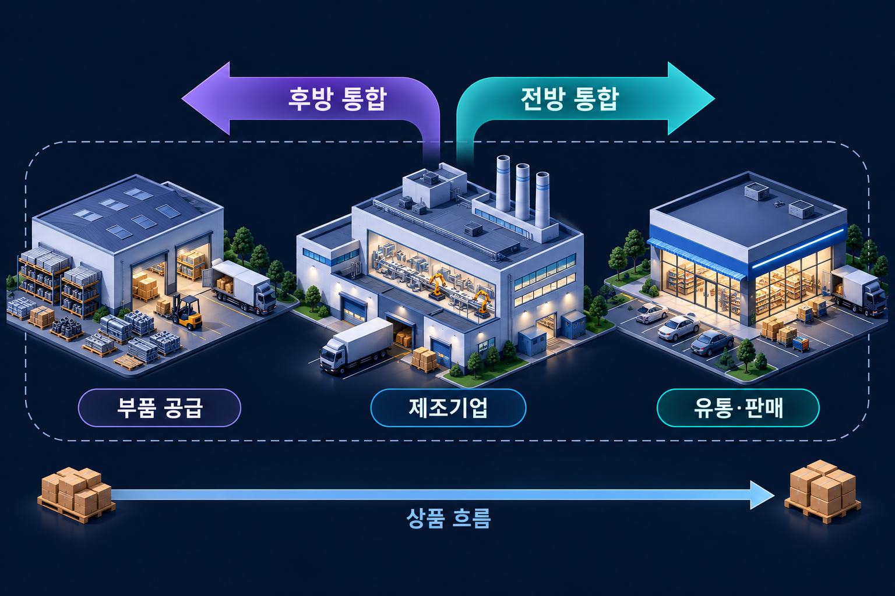

# 수직적 통합

수직적 통합은 공급이나 유통 등 가치사슬의 앞뒤 단계를 내부화하는 것이다.

{{틀:contracts-boundaries}}

## 가치가 생기는 조건

공유 가능한 기술·브랜드·판매망·구매력이 있거나 거래비용을 줄일 수 있다면 사업들을 함께 운영하는 이점이 생길 수 있다. 단순히 시장이 크거나 유행한다는 사실만으로 해당 기업의 진입이 정당화되지는 않는다.

## 비용과 위험

관리자의 주의력 분산, 복잡성, 내부 자원배분의 왜곡, 본업 투자 부족이 발생할 수 있다. 시너지의 주장과 실제 실현 비용을 분리하고, 인수 가격과 통합 과정까지 포함해 평가해야 한다.

## 후방 통합과 전방 통합
제조기업이 부품 공급자를 내부화하면 후방 통합, 유통·판매 단계를 내부화하면 전방 통합이다. 같은 단계의 경쟁기업을 결합하는 수평적 통합과 구분한다. 구매 비중이 크거나 장기계약을 맺었다는 사실만으로 소유·통제의 내부화가 이루어진 것은 아니다.

*위쪽 화살표는 제조기업을 기준으로 한 소유·통제 범위의 확장 방향이다. 아래의 상품 흐름과 구별한다. 점선은 세 단계를 함께 내부화할 수 있는 범위를 단순화한 예시다.*

## 통합이 유리할 수 있는 상황
전용 설비 투자가 크고 품질을 계약으로 검증하기 어렵다면 통합이 재협상과 홀드업 위험을 줄일 수 있다. 반대로 표준품의 공급자가 많고 기술이 빠르게 바뀌면 외부조달이 유연성과 전문화를 제공할 수 있다.

직접 소유 외에도 장기계약·합작·공동투자·복수조달이 대안이다. 통합 뒤에는 외부 공급자의 경쟁 압력이 줄고 내부 비용이 불투명해질 수 있으므로 조정 편익과 관료비용을 함께 비교한다.[^integration]

## 관련 문서

- [[diversification|다각화]]
- [[vrio|VRIO 분석]]
- [[transaction-costs|거래비용]]
- [[mergers-acquisitions|인수 · 합병]]

## 참고자료

- [OpenStax — 전략 목표와 수준](https://openstax.org/books/principles-management/pages/9-4-strategic-objectives-and-levels-of-strategy)

[^integration]: [Grossman·Hart — The Costs and Benefits of Ownership (1986)](https://doi.org/10.1086/261404)은 자산의 소유와 잔여통제권을 통해 통합의 편익·비용을 분석한다.

- [Grossman·Hart — The Costs and Benefits of Ownership (1986)](https://doi.org/10.1086/261404)

{{틀:management}}
