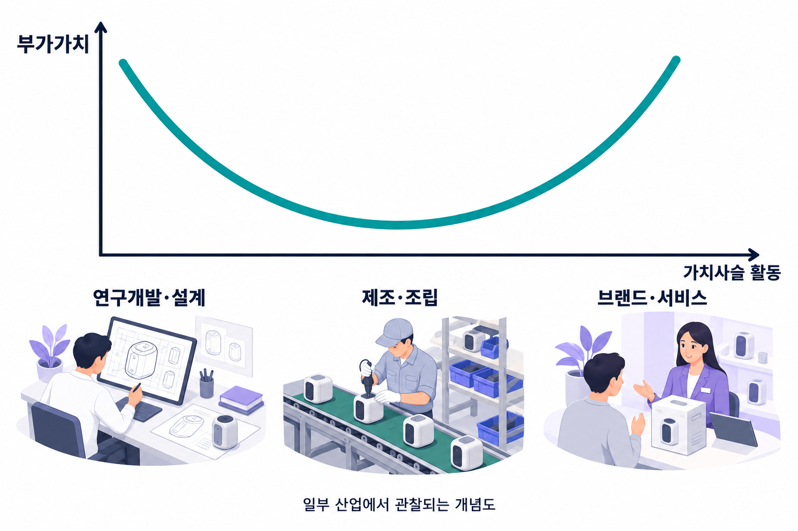

# 스마일 커브

스마일 커브는 일부 산업에서 연구개발·디자인 같은 상류 활동과 브랜드·서비스 같은 하류 활동의 부가가치가 조립보다 높게 나타날 수 있음을 설명하는 그림이다.

## 스마일 커브

모든 산업과 시기에 성립하는 보편 법칙은 아니다.

*일부 산업의 활동별 부가가치 분포를 단순화한 생성 이미지다. 곡선의 높이는 실제 측정값이 아니며, 가로축은 시간이 아니라 가치사슬의 활동을 뜻한다.*

## 곡선의 축과 의미
가로축은 연구개발·설계, 제조·조립, 판매·브랜드·서비스 같은 가치사슬의 활동 순서다. 세로축은 활동에서 창출하거나 포착하는 부가가치의 정도를 나타낸다. 가로축은 시간이 지나면 저절로 더 높은 단계로 이동한다는 성장 경로가 아니다.[^smile]

## 가운데가 낮아질 수 있는 이유
표준화된 조립은 대체 공급자가 많아 가격경쟁을 받는 반면, 특허·설계·브랜드·고객관계는 모방이 어렵거나 시장 접근을 통제할 수 있다. 이런 조건에서는 제조를 맡은 기업보다 지식과 유통을 통제하는 기업이 더 많은 몫을 얻을 수 있다.

## 활용과 한계
부가가치는 매출액·수출액·회계상 이익률과 같은 지표가 아니다. 복잡한 공정기술을 가진 제조기업은 높은 부가가치를 창출할 수도 있다. 따라서 ‘제조를 버리고 브랜드만 만들자’는 처방보다 어떤 활동에 희소한 역량과 협상력이 있는지 분석해야 한다.

가상의 조립기업이 설계·사후서비스로 확장하려면 기술·고객정보·판매망을 확보해야 한다. 곡선의 높은 부분으로 진입하는 데 필요한 투자와 실패 위험도 평가한다.

## 관련 문서

- [[value-chain|가치사슬]]
- [[shared-value|공유가치 창출]]
- [[supply-chain|공급망관리]]
- [[competitive-strategy|본원적 경쟁전략]]

## 참고자료

- [OpenStax — 자원·역량·가치사슬](https://openstax.org/books/principles-management/pages/8-5-the-internal-environment)

[^smile]: [WTO — Global Value Chain Development Report 2021](https://www.wto.org/english/res_e/booksp_e/00_gvc_dev_report_2021_e.pdf), 제1장. 산업별 부가가치의 분포와 무형 활동의 중요성을 다루며, 단순한 총수출액과 부가가치를 구분한다.
