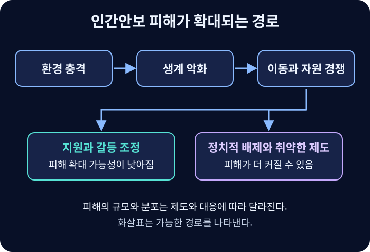

# 안보

보호할 대상과 핵심 가치를 정하고, 그 생존·생활·존엄을 위협하는 요인에 대응하는 문제.

## 보호 대상과 위협을 구분하기
국가안보는 주로 영토·주권·국가의 생존을 다루고, 인간안보는 개인과 공동체의 생명·생활·존엄을 중심에 둔다. 국가에 대한 군사적 위협만이 안보 문제인 것은 아니며, 비군사적 위협도 국가와 개인에 서로 다르게 작용한다.

국가가 존속하더라도 정부가 주민을 탄압하거나 기본 서비스를 제공하지 못하면 개인은 안전하지 않을 수 있다. 반대로 인간안보의 강화에도 행정·공공보건·사법 등 국가의 보호 역량이 필요하다.

## 안보 딜레마
한 국가가 방어를 위해 증강한 능력이 상대에게 공격 준비로 보이고, 상대의 대응이 다시 첫 국가의 불안을 키우는 상황이다. 양측이 현상유지와 안전을 원하더라도 의도에 대한 불확실성이 경쟁을 낳을 수 있다.

모든 군비경쟁을 안보 딜레마로 부르지는 않는다. 실제 팽창 목표가 있는 경우와 상호 오인 때문에 경쟁하는 경우는 다르다. 감시·군비통제·의사소통은 오판을 줄일 수 있지만 공격 의도를 자동으로 없애지는 않는다.

## 억제와 확장억제
억제는 상대가 행동을 시작하지 않도록 예상 비용과 실패 가능성을 높이는 것이다. 능력, 사용 의지의 신뢰성, 메시지 전달이 함께 중요하다. 이미 시작한 행동을 중단·철회시키려는 강요와 구분한다.

확장억제는 자국뿐 아니라 동맹국에 대한 공격도 억제하겠다는 약속이다. 핵우산은 미사일을 물리적으로 차단하는 장벽이 아니라 핵 능력에 기반한 억제 공약을 가리킨다. 확장억제 일반은 핵뿐 아니라 재래식 능력 등도 포함할 수 있다.

공약국이 동맹 방어를 위해 자국의 위험까지 감수할 것인지가 신뢰성의 쟁점이다. 협의·훈련·전력 배치 등은 공약을 보여주는 수단이 될 수 있지만 전쟁과 오판의 위험, 동맹의 연루 문제도 함께 평가해야 한다. 특정 배치·핵무장 방안의 효과를 개념의 정의에서 곧바로 도출할 수는 없다.

## 인간안보
UNDP의 1994년 『인간개발보고서』는 안보의 초점을 영토와 무기에서 인간과 개발로 옮겼다. 보편성·상호의존성·예방·인간 중심성이 중요하며, 공포로부터의 자유와 결핍으로부터의 자유를 함께 다룬다.[^human]

| 영역 | 보호하려는 조건 |
| --- | --- |
| 경제 | 기본 소득과 생계 기반 |
| 식량 | 충분하고 안전한 식량에 대한 접근 |
| 보건 | 질병과 취약한 의료 여건으로부터의 안전 |
| 환경 | 오염·재난·환경 훼손으로부터의 안전 |
| 개인 | 신체적 폭력으로부터의 안전 |
| 공동체 | 정체성과 공동체의 존속, 차별·집단폭력으로부터의 안전 |
| 정치 | 기본적 권리와 자유, 국가 억압으로부터의 안전 |

이 분류는 서로 독립적인 일곱 칸이 아니다. 생계 상실이 영양·건강·교육·정치적 배제와 연결되는 복합 경로를 찾는 데 사용한다.

## 기후와 분쟁의 복합 경로
가뭄과 생계 위기, 이주, 자원 경쟁은 정치적 배제·취약한 제도·기존 갈등과 결합해 폭력의 위험에 영향을 줄 수 있다.[^climate-conflict] 이를 ‘기후변화가 전쟁을 일으킨다’는 단일 인과관계로 축약하지 않는다. 비슷한 환경 충격에서도 공공서비스와 갈등 조정 능력에 따라 결과가 달라질 수 있다.

해수면 상승과 이주는 국토뿐 아니라 생계·공동체·정체성의 문제다. 이때 ‘기후난민’이라는 일상적 표현과 난민의 법적 지위는 구분해야 한다.

## 보호책임
2005년 유엔 세계정상회의가 합의한 보호책임(R2P)은 집단살해·전쟁범죄·인종청소·반인도적 범죄를 대상으로 한다. 국가의 1차적 보호책임, 국제사회의 지원, 국가가 주민을 보호하는 데 명백히 실패할 때의 적시적이고 단호한 대응이라는 틀이다.[^r2p]

빈곤·재난·감염병을 다루는 인간안보 전체와 적용 범위가 같지 않다. 자연재해나 정부의 역량 부족만으로 네 범죄의 맥락 없이 R2P의 적용이 자동으로 성립하지 않는다. 군사적 대응도 일반적인 일방 개입권을 뜻하지 않으며 유엔헌장과 안보리를 통한 집단적 결정의 문제를 수반한다.

## 안보화와 비례적인 대응
어떤 문제를 국가의 생존 위협으로 규정하면 긴급 자원과 예외적인 권한을 동원하기 쉬워진다. 안보화라는 관점은 위협의 물리적 크기뿐 아니라 누가 어떤 언어로 긴급성을 주장하고, 사회가 이를 받아들이는지 묻는다.

감염병·사이버 공격·이주를 다룰 때도 대응의 효과와 함께 권한의 범위·기간·감독·이의제기를 검토한다. 위협이 실제로 존재한다는 사실이 모든 비상조치를 정당화하는 것은 아니다. 보호할 가치인 자유와 존엄이 대응 과정에서 훼손되는지도 평가해야 한다.

## 군축과 군비통제
군축은 무기나 병력의 규모를 줄이는 데 초점을 둔다. 군비통제는 전력의 종류·배치·활동에 규칙을 정해 기습이나 오판의 위험을 낮추는 데 초점을 둔다. 총량을 줄이지 않아도 시험 발사 통보, 훈련 규모 공개, 위기 연락선은 상대가 일상 활동을 공격 준비로 오인할 가능성을 낮출 수 있다. 반대로 같은 수량을 줄여도 잔존 전력의 공격성이 달라지면 한쪽은 더 불안해질 수 있다.

합의의 효과를 살피려면 무엇을 제한하는지, 위반과 우연한 사고를 어떻게 구별하는지, 의심을 확인하고 분쟁을 처리할 통로가 있는지 확인한다. 1921~1922년 워싱턴 해군회의는 주요 해군력의 경쟁과 동아시아 긴장을 함께 다룬 역사적 사례다. [미국 국무부 역사실의 워싱턴 해군회의 기록](https://history.state.gov/milestones/1921-1936/naval-conference)

## 인간안보 위기는 어떻게 연쇄되는가

다르푸르를 분석할 때는 가뭄과 생계 악화, 경작지·목축 이동로의 경쟁, 정치적 배제와 조직화된 폭력을 구분한다. 같은 가뭄도 토지 분쟁을 조정할 수 있고 피해 집단이 지원을 받을 수 있다면 다른 결과를 낳는다.[^pathways-scope] 저지대 섬 주민의 이주에서는 주택을 옮기는 문제에 더해 식수, 일자리, 언어와 공동체를 어떻게 유지할지 살핀다. 국경을 넘는 경우에는 정착지의 노동 조건과 차별 위험도 달라진다.

감염병 대응에서도 진료역량만 보면 격리 중의 소득 상실, 교육과 돌봄의 단절을 놓친다. 의료 접근, 소득 보전, 허위정보 대응은 연쇄의 서로 다른 지점에 개입한다. 피해를 줄일 수단을 정하려면 위험이 처음 나타난 영역과 그 피해가 최종적으로 집중되는 집단을 모두 확인한다.

## 관련 문서
- [[international-institutions|국제제도]] · [[balance-of-power|세력균형]]
- [[rights|권리]] · [[prejudice|편견]] · [[net-zero|탄소중립]]

## 출처
- [Buzan·Wæver·de Wilde — Security: A New Framework for Analysis (1998)](https://www.rienner.com/title/security_a_new_framework_for_analysis): 안보화와 확장된 안보 의제.
- [NATO — 핵억제 정책과 전력](https://www.nato.int/en/what-we-do/deterrence-and-defence/natos-nuclear-deterrence-policy-and-forces.)

[^human]: [UNDP — Human Development Report 1994](https://hdr.undp.org/content/human-development-report-1994) · [UNDP — Human Security and Human Development](https://hdr.undp.org/system/files/documents/primercomplete.pdf). 일곱 영역은 국가 산업경쟁력의 일곱 요소가 아니라 사람의 안전에 관한 분류다.
[^r2p]: [유엔 — 보호책임과 2005년 합의문 138–139항](https://www.un.org/en/genocide-prevention/responsibility-protect/about). 일반적인 인도적 지원과 네 가지 잔혹범죄를 대상으로 하는 보호책임을 구별해야 한다.

[^climate-conflict]: [IPCC AR6 WGII — Technical Summary, TS.B.7.4](https://www.ipcc.ch/report/ar6/wg2/chapter/technical-summary/). 기후와 분쟁의 관계는 사회경제적 조건에 의존하며, 인위적 기후변화에 무력충돌을 곧바로 귀속할 충분한 근거가 있다는 뜻은 아니다.

{{틀:international}}

[^pathways-scope]: 그림은 영향을 주고받는 경로를 구분한 설명용 도식이다. 화살표는 다르푸르에서 각 요인의 효과가 따로 측정됐거나 단일한 인과 순서가 확정됐음을 뜻하지 않는다.
