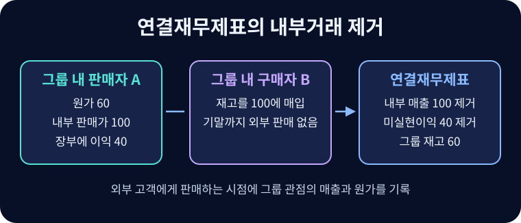

# 연결재무제표

지배기업과 종속기업의 재무상태와 성과를 하나의 경제적 실체로 표시하는 재무제표.

## 보고 범위

**연결재무제표**는 지배기업과 종속기업을 함께 보고한다. **별도재무제표**는 해당 기업 자체의 자산·부채와 함께 종속기업 등에 대한 투자지분을 투자 계정으로 표시한다. 적용 기준에 따라 그 투자지분은 원가, IFRS 9 또는 지분법 등으로 회계처리할 수 있다. 종속기업을 갖지 않은 기업 자체의 재무제표를 실무상 개별재무제표라고 부르는 경우도 있다. 흡수합병·신설합병은 법인의 구조를 바꾸는 거래다. 지분 취득으로 지배력을 얻으면 두 법인이 남아 있어도 연결 범위에 들어갈 수 있다.

## 지배력

IFRS 10에서 지배력이 성립하려면 투자자가 관련 활동을 지시할 **힘**, 관여에 따른 **변동이익에 대한 노출 또는 권리**, 힘을 사용해 그 이익에 **영향을 미칠 능력**을 모두 가져야 한다. 관련 활동은 수익에 유의적인 영향을 주는 활동이다. 보유율이 50% 미만이어도 나머지 지분이 널리 분산되어 의사결정을 사실상 주도할 수 있다. 반대로 의결권이나 명목상 소유권이 있어도 실질적인 의사결정권이 외부 관리인에게 있거나 투자자가 다른 당사자의 대리인이라면 지배력이 달라질 수 있다. 특수목적기구처럼 관련 활동의 결정 방식이 계약에 의해 정해진 경우에는 설계 목적, 의사결정권, 위험과 보상도 살핀다.

## 취득일과 이후 연결

지배력을 얻은 날부터 종속기업을 연결한다. 사업결합의 취득법에서는 식별가능한 자산과 부채를 원칙적으로 취득일 공정가치로 측정하고, 이전대가와 비지배지분 등을 반영해 영업권을 계산한다.

$$GW=C+NCI+H-(A_f-L_f)$$

$C$는 이전대가, $NCI$는 취득일 비지배지분, $H$는 단계 취득에서 기존 보유지분의 취득일 공정가치다. $A_f-L_f$는 식별가능한 순자산의 취득일 인식액이다. 합계가 순자산보다 작으면 측정을 재검토한 뒤 남은 염가매수차익을 당기손익에 반영한다. 사업에 해당하지 않는 자산집합 취득은 사업결합과 구분한다.

순자산 100인 종속기업의 80%를 96에 취득하고 비지배지분을 순자산 비례액 20으로 측정하면 영업권은 $96+20-100=16$이다. 종속기업의 자산·부채를 각각 전액 합산하고, 모회사의 투자 계정과 종속기업의 취득일 자본을 연결 조정에서 제거한다. 비지배지분은 연결 자본 내에서 지배기업 소유주 몫과 구분한다. 이후 종속기업의 순이익 30 중 6이 비지배지분 몫이라면 연결손익에 30을 반영하고, 그 귀속을 24와 6으로 표시한다. 취득일 측정 차이와 내부거래 조정을 생략한 예다.

## 내부거래 제거

그룹 내부 대여금과 차입금, 매출채권과 매입채무, 내부 매출과 대응 비용은 연결에서 상계한다. 원가 60의 상품을 그룹 내에서 100에 넘겼고 기말까지 외부에 팔지 않았다면, 연결 재고의 기준은 그룹 원가 60이다. 내부이익 40을 제거하고 나중에 외부 판매가 이루어질 때 연결손익에 반영한다. 하향판매와 상향판매는 내부이익 제거가 비지배지분 귀속에 영향을 주는 방식이 다를 수 있다.

조정분개를 하나로 합치면 차변 매출 100, 대변 매출원가 60, 대변 재고 40이다. 판매자의 내부 매출과 매출원가를 취소하고 구매자의 재고를 그룹 원가로 낮추는 구조다. 기말에 절반만 남아 있다면 미실현이익은 $(100-60)\times0.5=20$이며, 나머지 절반은 이미 외부 판매에 따라 실현되었다.[^upstream]

연결에는 회계정책과 보고기간을 맞추는 조정도 필요하다. 해외 종속기업은 [[foreign-currency-translation|외화환산]] 후 합산한다. 연결 매출은 그룹 외부 고객 매출을 보여 주고 [[segment-reporting|영업부문]] 수치에는 경영진이 보는 내부거래가 포함될 수 있다.

예를 들어 모회사가 자체 매출 600과 종속기업 배당수익 8을, 종속기업이 자체 매출 300을 보고했다고 하자. 자체 매출 중 내부 공급이 100이라면 연결 매출은 $600+300-100=800$이다. 종속기업의 이익은 이미 수익과 비용을 합산하는 과정에서 반영되므로 내부 배당수익 8도 제거한다. 비지배주주에게 지급한 배당은 그룹 밖의 소유주에 대한 배분이다.

## 관련 문서

- [[financial-statements|재무제표]]
- [[mergers-acquisitions|인수·합병]]
- [[intangible-assets|무형자산]]
- [[financial-liabilities|금융부채]]

## 참고자료

- [IFRS Foundation — IFRS 10 연결재무제표](https://www.ifrs.org/issued-standards/list-of-standards/ifrs-10-consolidated-financial-statements/)
- [IFRS Foundation — IFRS 3 사업결합](https://www.ifrs.org/issued-standards/list-of-standards/ifrs-3-business-combinations/)
- [IFRS Foundation — IAS 27 별도재무제표](https://www.ifrs.org/issued-standards/list-of-standards/ias-27-separate-financial-statements/)

[^upstream]: 단순 예에서 지배기업이 종속기업에 판매한 하향거래는 제거 효과가 지배기업 소유주에게 귀속된다. 종속기업이 판매자인 상향거래는 종속기업 손익에서 내부이익을 제거하므로 비지배지분 몫도 영향을 받을 수 있다. 예에서는 세효과와 별도 조정을 생략했다.
