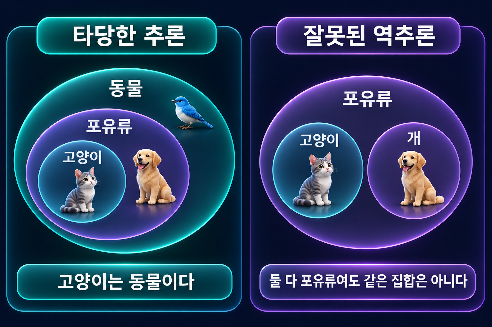

# 연역논증

전제의 참이 결론의 참을 보장하는 타당성과 건전성.

## 타당성
**연역논증**(Deductive Argument)은 전제가 참이라면 결론도 반드시 참이라고 주장하는 논증이다. 그 보장이 실제로 성립하면 **타당**하다. 판단 기준은 모든 전제가 참이면서 결론만 거짓인 경우가 가능한가이다.

일반적인 것에서 구체적인 것으로 간다는 방향만으로 연역을 정의할 수는 없다. 핵심은 주장되는 지지의 필연성이다.

## 건전성
**건전한 논증**은 타당하면서 모든 전제가 실제로 참인 논증이다.

| 평가 | 질문 |
| --- | --- |
| 타당성 | 전제를 모두 참으로 가정해도 결론이 거짓일 수 있는가? |
| 전제의 진실성 | 전제가 실제 사실에 부합하는가? |
| 건전성 | 타당성과 전제의 진실성을 모두 충족하는가? |

“모든 고양이는 새다. 모든 새는 동물이다. 그러므로 모든 고양이는 동물이다”는 타당하지만 첫 전제가 거짓이므로 건전하지 않다. 결론이 참이라는 사실이 거짓 전제를 고쳐 주지는 않는다.

## 반례로 부당성을 보이기
“모든 개는 포유류다. 모든 고양이는 포유류다. 그러므로 모든 고양이는 개다”는 전제가 모두 참이고 결론이 거짓인 반례가 있다. 형식만 비교하려면 같은 구조를 유지하면서 전제를 참, 결론을 거짓으로 만드는 사례를 찾는다.

## 모순된 전제

왼쪽에서는 고양이 집합이 포유류에, 포유류 집합이 동물에 포함되므로 고양이가 동물이라는 결론이 따라온다. 오른쪽은 두 집합이 같은 상위 집합에 포함되어도 서로 포함될 필요가 없음을 보여 주는 반례다. 원의 크기는 실제 개체 수를 나타내지 않는다.

고전논리에서는 함께 참일 수 없는 전제들로 이루어진 논증은 어떤 결론에 대해서도 타당하다. 전제가 모두 참이고 결론이 거짓인 경우가 애초에 없기 때문이다. 그러나 그 전제들은 모두 실제로 참일 수 없으므로 논증은 건전하지 않다. 이 성질은 모순에서 무엇이든 도출되는 폭발 원리와 연결된다.

## 추론 능력의 한계
어떤 전제에서 결론이 논리적으로 따라온다는 사실과 사람이 그 결론을 이미 알고 있다는 사실은 다르다. 계산 시간·주의력·증명 능력이 필요할 수 있다. 논리적 전지성 문제는 지식의 이상화된 모델이 이런 제약을 생략할 때 발생한다.

## 관련 문서
- [[argument|논증]] · [[propositional-logic|명제논리]]
- [[categorical-syllogism|정언삼단논법]] · [[bounded-rationality|제한된 합리성]]
