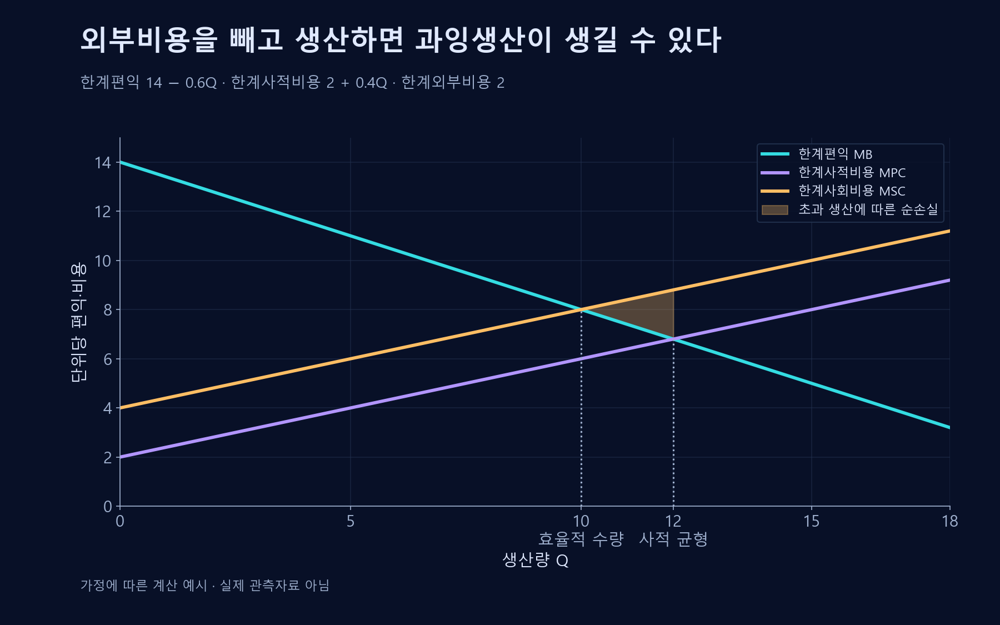

# 외부효과

거래에 참여하지 않은 제3자에게 발생하지만 가격에 충분히 반영되지 않는 영향.

## 정의
**외부효과**(Externality)는 생산·소비가 제3자에게 보상되지 않은 편익이나 비용을 주는 현상이다. 피해가 생기는 부정적 외부효과와 편익이 생기는 긍정적 외부효과를 구분한다. 경쟁사의 매출이 가격경쟁 때문에 줄었다는 사실만으로 같은 종류의 외부효과라고 보지는 않는다.

*생산자와 구매자 사이의 거래 밖에서 주민이 비용을 부담하는 부정적 외부효과의 예시다. 청록색 화살표는 상품의 전달, 주황색 파동은 소음 피해를 나타낸다.*

## 사회적 비용과 사적 비용
오염처럼 외부비용이 있는 경우 다음 관계로 나타낼 수 있다.
$$MSC=MPC+MEC$$
$MSC$는 한계사회비용, $MPC$는 한계사적비용, $MEC$는 한계외부비용이다. 기업이 사적 비용만 보고 생산하면 외부비용이 존재하는 범위에서 과잉생산이 생길 수 있다.

## 예시
가상의 공장이 생산비는 줄였지만 인근 주민에게 소음 피해를 준다면, 제품의 가격은 주민이 부담하는 비용을 충분히 반영하지 못할 수 있다. 반대로 연구개발 지식이 다른 기업으로 확산되면 사회적 편익이 투자자의 수익보다 커질 수 있다.

## 대응
세금·보조금·기준·배출권·재산권 조정 등을 통해 의사결정자가 외부영향을 고려하게 만드는 것을 내부화라고 한다. 어느 수단도 자동으로 최적은 아니며 측정·감독·거래비용을 비교해야 한다.

## 사회적 가치와의 관계
외부비용을 줄이는 활동은 사회적 가치를 만들 수 있다. 그러나 비용을 다른 지역이나 공급망으로 옮긴 것이라면 전체 영향이 개선되었다고 단정하기 어렵다.

## 한계비용 관계의 유도와 정책
생산량을 $Q$, 사적 총비용을 $PC(Q)$, 제3자에게 발생하는 외부 총비용을 $EC(Q)$라 하자. 사회적 총비용 $SC(Q)=PC(Q)+EC(Q)$를 생산량으로 미분하면 다음과 같다.

$$MSC(Q)=\frac{dSC}{dQ}=\frac{dPC}{dQ}+\frac{dEC}{dQ}=MPC(Q)+MEC(Q)$$

여기서 한계비용은 ‘추가 한 단위’가 만드는 비용이며 평균비용과 다르다. 효율적 생산량에서는 한계사회편익과 $MSC$를 비교한다. 소비의 외부효과가 없으면 편익 쪽은 수요자의 한계편익으로 볼 수 있다.

효율적 생산량에서의 한계외부비용만큼 단위세를 부과하는 피구세는 사적 선택에 외부비용을 반영하려는 장치다. 다만 피해와 감축비용의 정보, 집행비용, 다른 왜곡이 있으면 실제 정책의 최적 수준을 별도로 분석해야 한다.

## 사적 균형과 효율적 생산량

가상의 한계편익 $MB=14-0.6Q$, 한계사적비용 $MPC=2+0.4Q$, 한계외부비용 $MEC=2$를 가정했다. $Q$는 생산량이고 모든 편익·비용은 추가 한 단위당 금액이다. 사적 선택은 $MB=MPC$인 12에서, 효율적 선택은 $MB=MSC=MPC+2$인 10에서 결정된다.

10을 넘는 추가 생산에서는 사회적 한계비용이 편익보다 높다. 음영은 10부터 12까지 발생하는 순손실이며, 이 예의 면적은 $\frac12\times(12-10)\times2=2$다. 외부비용이 일정하고 소비 측 외부효과가 없다는 가정에 따른 예시다.

## 편익과 부담을 다른 사람에게 넘기는 사례
데이터센터가 같은 연산량에 필요한 전력과 냉각수를 줄이면 회사는 비용을 절감하고, 발전과 취수에서 발생하는 외부 피해도 줄어들 수 있다. 어느 정도 피해가 줄었는지는 전력의 공급원, 지역의 물 부족, 실제 연산량 변화에 달려 있다. 단위당 에너지가 감소해도 전체 연산량이 더 빠르게 늘면 총전력 사용량은 커질 수 있다.

반대로 수리 서비스를 제공해 제품의 사용 기간을 늘리면 고객의 교체비용과 폐기물 부담을 낮출 수 있다. 서비스의 가격에 반영되는 고객 편익과 거래 외부의 폐기·오염 감소는 구분한다. 새로운 사업의 사회적 효과를 계산할 때는 사업이 없었으면 일어났을 수리·재사용도 비교 기준에 넣는다.

## 관련 문서
- [[market-failure|시장실패]]
- [[public-goods|공공재]]
- [[net-zero|탄소중립]]

## 참고자료
- [IMF — 외부효과](https://www.imf.org/en/publications/fandd/issues/series/back-to-basics/externalities)
