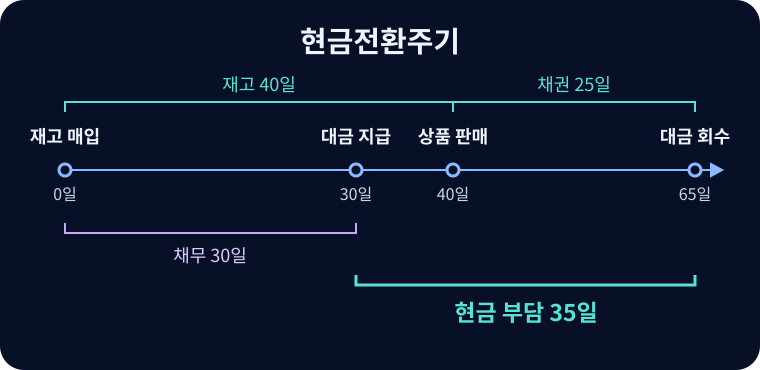

# 운전자본

일상 영업에서 재고 매입, 고객 회수, 공급업체 지급 사이에 묶이는 자금.

{{틀:accounting-operations}}

## 순운전자본의 범위

넓은 뜻의 순운전자본은 유동자산에서 유동부채를 뺀 금액이다. 영업 순운전자본은 현금과 이자부채 등 재무 항목을 제외하고 영업 관련 유동자산·부채의 차이를 본다. 단순한 상품 사업이라면 매출채권과 재고의 합에서 매입채무를 뺀다. 선급비용·계약부채 등을 포함할 때는 분석 목적에 따라 범위를 명시한다. 영업 순운전자본이 늘면, 다른 조건이 같을 때 해당 금액만큼 현금이 영업에 추가로 묶인다.

## 현금전환주기

$$DIO=\frac{\text{평균 재고}}{\text{매출원가}}T,\quad
DSO=\frac{\text{평균 매출채권}}{\text{외상매출액}}T,\quad
DPO=\frac{\text{평균 매입채무}}{\text{외상매입액}}T$$

$T$는 분석기간의 일수이며 연간이면 보통 365일이다. 평균잔액은 기초와 기말의 평균을 쓰되 계절성이 크면 월별 평균을 고려한다. DIO는 재고가 판매되기까지, DSO는 판매에서 대금 회수까지, DPO는 매입에서 공급업체 지급까지의 평균 일수다. 외상매출이나 외상매입액을 구할 수 없으면 총매출이나 매출원가 등을 근사치로 쓰고 그 한계를 밝힌다. 단순한 상품기업에서는 매출원가에 재고 증가를 더해 총매입을 근사할 수 있다.

$$CCC=DIO+DSO-DPO$$

매입에서 고객 회수까지 $DIO+DSO$일이 걸리고, 그중 공급업체가 지급을 기다려 주는 $DPO$일을 빼면 기업이 현금을 먼저 부담하는 기간이 된다. 그림의 예에서 재고 40일과 채권 25일을 합한 65일 중 매입채무 30일을 빼면 35일이다. 공급업체에 지급하기 전에 고객이 현금을 내는 사업은 CCC가 음수일 수 있다. 선수금으로 미리 확보한 현금은 플로트가 되지만 서비스 제공이나 환불 의무가 남으며 단순 CCC에 완전히 반영되지 않는다.

## 지급조건과 공급망금융

매입채무는 영업 과정에서 생기는 자금조달원이다. 지급일수 증가로 CFO가 좋아져도 협상력 상승, 공급업체 지급 지연, 유동성 압박을 구분해야 한다. 조기지급 할인도 비교한다. 예컨대 10일 이내 지급 시 2% 할인, 아니면 30일에 전액 지급이라면 20일 추가 신용의 비용은 할인액 2를 조기지급액 98로 나눈 약 2.04%다.

역팩토링(Reverse Factoring)에서는 금융기관이 공급업체에 먼저 지급하고 구매자가 약정일에 금융기관에 지급한다. 구매자는 계약의 성격·만기·담보와 기존 매입채무가 소멸했는지를 검토해 매입채무 유지, 별도 표시 또는 차입금 분류를 판단한다. 공급업체 지급 당시 구매자에게 현금 이동이 없다면 비현금 변동을 확인한다. 약정 조건, 포함된 부채와 표시 항목, 금융기관이 이미 지급한 금액, 지급기일 범위와 유동성 위험이 분석에 중요하다.

## 회수와 거래 가격 분석

채권 증가율이 매출 증가율보다 높은지, 장기 연체가 늘었는지, 결제조건이 바뀌었는지 확인한다. 재고 일수 단축도 정상 판매, 할인 처분, 공급 차질로 해석이 갈린다. DPO 상승과 DSO 하락이 분기말에만 나타났다면 다음 분기 반전을 살핀다.

인수계약에서 **운전자본 기준액**(Working Capital Peg)은 정상적인 영업을 유지하는 데 필요한 합의 잔액이다. 실제 종결 잔액과 기준액의 차이를 가격에 반영하는 계약이 많다. 계절성, 정상화 기간, 연체 채권과 불용재고, 계약부채 및 공급망금융의 포함 여부가 기준액과 정산액을 바꾼다. 분석에 쓰는 회계상 운전자본 정의와 인수계약의 정의를 각각 확인한다.

## 관련 문서

- [[cash-flow-statement|현금흐름표]]
- [[trade-receivables|매출채권]]
- [[inventories|재고자산]]
- [[financial-ratios|재무비율]]

## 참고자료

- [IFRS Foundation — IAS 7 현금흐름표와 공급자금융약정](https://www.ifrs.org/issued-standards/list-of-standards/ias-7-statement-of-cash-flows/)
