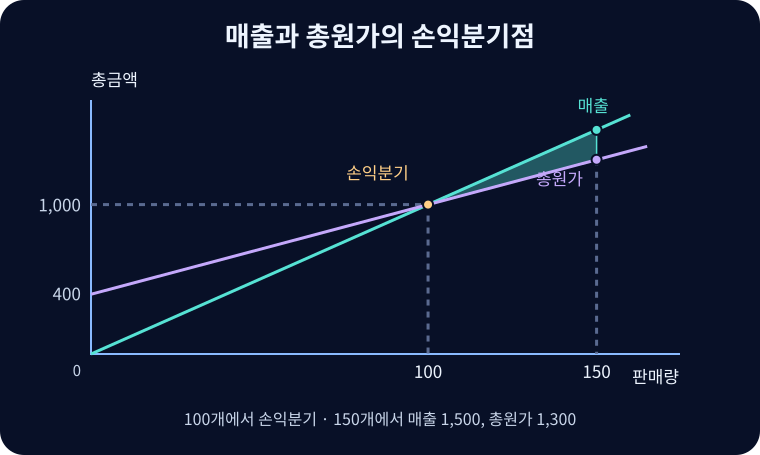

# 원가·조업도·이익 분석

판매량과 가격, 원가 구조가 손익분기점과 영업이익의 민감도에 미치는 영향을 살피는 방법.

{{틀:costs-and-profit}}

## 공헌이익

**원가·조업도·이익 분석**(Cost–Volume–Profit Analysis, CVP)은 일정한 관련범위에서 단위 판매가격과 단위변동원가, 총고정원가가 일정하다고 가정한다. 단일 상품에서 생산량과 판매량이 같으며 생산성 변화와 규모의 경제가 없다고 둔다. 복수 상품은 일정한 판매구성을 별도로 가정한다. 임대료는 계약 기간에 고정인 경우가 많고, 포장재는 판매에 비례하는 경우가 많다. 인건비·전기료는 계약과 사용량에 따라 혼합원가일 수 있다.

$$\pi=pQ-vQ-F=(p-v)Q-F,\qquad m=\frac{p-v}{p}=1-\frac{v}{p}$$

$Q$는 판매량, $p$는 단위 판매가격, $v$는 단위변동원가, $F$는 총고정원가, $\pi$는 이 모형의 영업이익이다. $p-v$는 단위 공헌이익으로, 한 단위를 더 팔 때 고정원가 회수와 이익에 기여하는 금액이다. $m$은 공헌이익률로 매출 1원 중 변동원가를 제하고 남는 비율이다. 공헌이익은 변동 판매비 등을 차감하고 고정 제조원가를 따로 보는 내부 분석 지표다. 매출원가를 빼는 외부보고용 매출총이익과 차감 항목이 다르다.

## 손익분기점과 목표이익

$$Q_{\mathrm{BEP}}=\frac{F}{p-v},\qquad S_{\mathrm{BEP}}=\frac{F}{m}$$

손익분기점에서는 총공헌이익이 고정원가와 같다. 단위 공헌이익이 양수일 때 두 식은 각각 필요한 판매 수량과 매출액을 준다. 정수 단위로 팔면 최소 판매량을 올림한다. 단위 공헌이익이 0 이하이고 고정비가 양수라면 판매량 증가만으로 손익분기점에 도달하지 못한다.

$$Q_{\mathrm{target}}=\frac{F+\pi^*}{p-v},\qquad S_{\mathrm{target}}=\frac{F+\pi^*}{m}$$

$\pi^*$는 목표 영업이익이다. 단위당 가격 10, 변동원가 6, 고정비 400이면 공헌이익 4와 공헌이익률 40%를 얻는다. 100개에서 손익분기점이고 이익 200을 얻으려면 150개, 매출 1,500이 필요하다. 가격을 9로 할인하면 단위 공헌이익은 3이고, 같은 이익을 위해 200개를 팔아야 한다. 남는 생산능력, 기존 고객 매출 잠식, 장기적인 가격 기대도 가격 결정에 영향을 준다.

그림에서 매출선의 기울기는 판매가 10이고, 총원가선은 고정비 400에서 시작해 1개당 6만큼 올라간다. 두 선의 높이 차이는 이익이다. 150개를 팔 때 손익분기점까지의 여유는 50개다. 판매량이 현재보다 $50/150=33.3\%$ 줄면 이익이 0이 되므로, 가격과 원가가 그대로인 경우 **안전한계율**은 33.3%다.[^range]

## 영업레버리지와 하방경직성

$$DOL=\frac{(p-v)Q}{\pi}=\frac{\Delta\pi/\pi}{\Delta S/S}$$

$S=pQ$는 기준 매출액이며 이 변화율은 기준점의 이익과 매출로 나눈다. 같은 단가·원가 구조에서 기준 판매 150개의 공헌이익은 600, 이익은 200이므로 DOL은 3이다. 판매량과 매출이 10% 줄면 이익은 30% 줄어 140이 된다. 이익이 0인 손익분기점에서는 DOL을 정의할 수 없고 적자 구간에서는 부호 해석에 주의한다. 가격·상품구성·생산능력이 바뀌면 같은 민감도를 적용하기 어렵다.

설비를 선제 투자하는 기업은 고정비를 부담하는 대신 규모 확대 시 높은 추가 마진을 확보할 수 있다. 외주나 변동형 계약은 불황기의 부담을 낮출 수 있으나 호황기에는 단위 원가가 더 높을 수 있다. 매출이 감소해도 임대·고용 계약, 조정비용, 일시적 하락이라는 판단 때문에 비용을 바로 줄이지 못하는 **원가의 하방경직성**도 살핀다. 매출 증가와 감소에 대해 비용의 반응이 대칭이라는 가정은 실적 분석에서 확인할 사항이다.

소비자의 지불의사가 가격보다 높고 가격이 관련 원가를 상회하는 거래는 양쪽에 잉여를 남긴다. 기업 전체가 장기적으로 지속되려면 판매 단위의 마진에 더해 총고정비와 투자자본의 기회비용까지 회수할 수 있는지를 살펴야 한다.

## 관련 문서

- [[financial-statements|재무제표]]
- [[financial-ratios|재무비율]]
- [[economies-of-scale|규모의 경제]]
- [[production-costs|생산비용]]

[^range]: 생산 설비를 추가해 고정비가 한 단계 오르거나 주문 규모에 따라 단위 변동비가 바뀌면 직선의 절편이나 기울기가 바뀐다. 이때는 관련범위별로 가능한 손익분기점을 구해 그 수량이 해당 범위 안에 있는지 확인한다.
