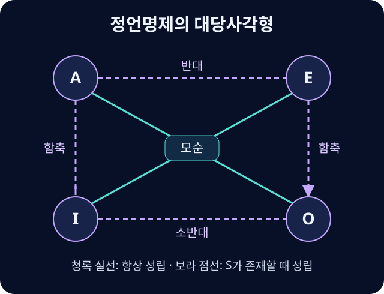

# 정언명제

A·E·I·O 명제의 수량·성질과 존재 가정, 대당관계.

{{틀:logic-categorical}}

## 네 가지 표준형식
**정언명제**(Categorical Proposition)는 주어에 해당하는 집합 S와 술어에 해당하는 집합 P의 관계를 나타낸다. 양화사·주사·계사·빈사로 구성되며 전칭/특칭과 긍정/부정을 조합한다.

| 기호 | 종류 | 표준 표현 | 현대적 해석 |
| --- | --- | --- | --- |
| A | 전칭 긍정 | 모든 S는 P다 | P가 아닌 S가 없다 |
| E | 전칭 부정 | 어떤 S도 P가 아니다 | P인 S가 없다 |
| I | 특칭 긍정 | 어떤 S는 P다 | S이면서 P인 것이 적어도 하나 있다 |
| O | 특칭 부정 | 어떤 S는 P가 아니다 | S이면서 P가 아닌 것이 적어도 하나 있다 |

여기서 ‘어떤’은 ‘적어도 하나’다. 반드시 ‘일부만 있고 나머지는 없다’는 뜻이 아니다.

## 존재 가정
현대적 해석에서 A와 E는 S의 존재를 보장하지 않는다. “모든 유니콘은 뿔이 있다”가 참이라고 해도 유니콘의 존재를 도출할 수는 없다. I와 O는 해당 대상의 존재를 포함한다.

전통적 대당사각형의 관계를 사용하려면 주어 집합이 비어 있지 않다는 존재 가정을 확인해야 한다. 존재 가정 없이 A에서 I, E에서 O를 도출하면 존재론적 오류가 발생한다.

## 대당관계
현대적 해석에서도 A와 O, E와 I는 모순관계다.[^opposition-identity] 각각 동시에 참일 수도, 동시에 거짓일 수도 없다.

S의 존재를 가정하는 전통적 사각형에서는 A와 E가 함께 참일 수 없는 반대관계, I와 O가 함께 거짓일 수 없는 소반대관계가 성립한다. A에서 I, E에서 O로의 함축도 가능하다. S가 비어 있으면 A와 E가 모두 참이고 I와 O가 모두 거짓일 수 있으므로 이 추가 관계들은 그대로 적용되지 않는다.

## 환위·환질·이환
**환위**는 S와 P의 위치를 바꾸는 조작으로 E와 I에서 동치를 보존한다. **환질**은 긍정/부정을 바꾸고 술어를 그 여집합으로 바꾸는 조작으로 네 형식 모두에서 동치를 보존한다. **이환**은 두 항을 맞바꾸고 각각 여집합으로 바꾸며 A와 O에서 동치를 보존한다.

예를 들어 “모든 고양이는 동물이다”에서 “모든 동물은 고양이다”라는 환위는 성립하지 않지만 “모든 비동물은 비고양이다”라는 이환은 성립한다. 여집합을 말할 때는 논의 영역을 고정해야 한다.

## 대당사각형을 읽는 법

대각선은 한쪽이 참일 때 다른 쪽이 반드시 거짓이라는 뜻이다. 예를 들어 “모든 S는 P다”가 거짓이라면 P가 아닌 S가 적어도 하나 있으므로 O가 참이다. 반면 A가 거짓이라고 해서 E가 참이라는 보장은 없다. S 가운데 P인 대상과 P가 아닌 대상이 모두 있으면 두 전칭명제가 함께 거짓이다.

| S에 속한 대상의 상태 | A | E | I | O |
| --- | --- | --- | --- | --- |
| S가 비어 있음 | 참 | 참 | 거짓 | 거짓 |
| S가 있으며 전부 P임 | 참 | 거짓 | 참 | 거짓 |
| S가 있으며 어느 것도 P가 아님 | 거짓 | 참 | 거짓 | 참 |
| P인 S와 P가 아닌 S가 모두 있음 | 거짓 | 거짓 | 참 | 참 |

### 조작의 결과를 검산하기
A형에서 $S\subseteq P$이면 $S\cap P^c=\varnothing$이므로 “어떤 S도 비P가 아니다”라는 환질은 같은 내용을 말한다. E형에서는 $S\cap P=\varnothing$이므로 “모든 S는 비P다”가 된다. I와 O 역시 교집합에 원소가 있다는 조건을 유지하면서 긍정과 부정을 바꿀 수 있다. 여기서 $P^c$는 논의 영역 안에서 P에 속하지 않는 대상의 집합이다.

## 일상 문장을 표준형으로 바꾸기
“오직 정회원만 투표할 수 있다”는 모든 투표 가능자가 정회원이라는 A형이다. 정회원 모두가 투표 가능하다는 역방향은 별도 전제가 필요하다. “안전요원을 제외한 모든 참가자는 출입 금지다”에서 확실히 얻는 내용은 안전요원이 아닌 참가자에게 출입 금지가 적용된다는 것이다. 안전요원의 실제 출입 허용이나 예외 집단의 존재를 주장하는지는 문맥을 확인한다. “오직 한 사람”은 수량이 정확히 하나라는 표현이므로 단순한 I형으로 옮기면 정보가 줄어든다.

## 관련 문서
- [[categorical-syllogism|정언삼단논법]] · [[intension-extension|내포와 외연]]
- [[necessary-sufficient|필요조건과 충분조건]]

{{틀:logic}}

[^opposition-identity]: A는 $S\cap P^c=\varnothing$, O는 $S\cap P^c\ne\varnothing$을 뜻한다. E와 I도 같은 교집합 $S\cap P$가 비어 있는지에 관해 서로 반대되는 진릿값을 가진다.
