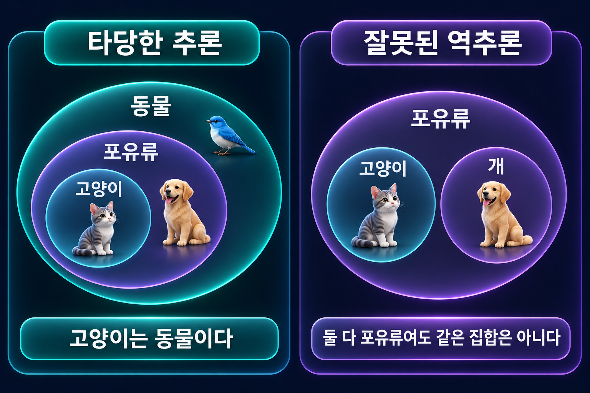
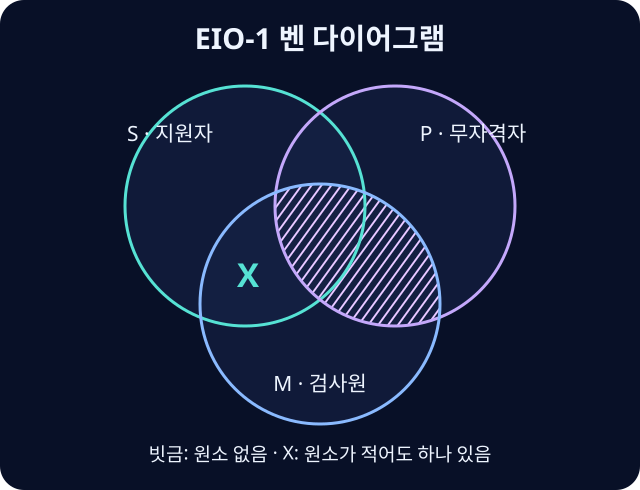

# 정언삼단논법

세 개념을 연결하는 정언논증의 식·격과 타당성 검토.

## 세 명제로 이루어진 논증
**정언삼단논법**(Categorical Syllogism)은 두 전제와 한 결론이 모두 정언명제이며 정확히 세 개의 항을 연결하는 논증이다. 결론의 주어를 소개념 S, 술어를 대개념 P, 두 전제에 등장해 연결 역할을 하는 항을 매개념 M이라고 한다.

대전제는 P와 M을, 소전제는 S와 M을 포함한다. ‘대’와 ‘소’는 명제의 중요도나 집합의 크기를 뜻하지 않는다.

## 식과 격
식(mood)은 대전제·소전제·결론의 A·E·I·O 유형을 순서대로 적은 것이다. 격(figure)은 두 전제 안에서 M의 위치로 정한다.

| 격 | 대전제의 항 순서 | 소전제의 항 순서 |
| --- | --- | --- |
| 1격 | M–P | S–M |
| 2격 | P–M | S–M |
| 3격 | M–P | M–S |
| 4격 | P–M | M–S |

모든 M은 P다 / 모든 S는 M이다 / 그러므로 모든 S는 P다는 AAA-1이며 현대적 해석에서도 타당하다.

## 벤 다이어그램으로 검사

왼쪽에서 S를 고양이, M을 포유류, P를 동물로 읽으면 AAA-1의 포함관계를 확인할 수 있다. 오른쪽처럼 두 항이 모두 M에 속한다는 것만으로는 두 항 사이의 포함관계를 얻을 수 없다. 이 그림은 구체적인 포함 사례이며, 일반적인 세 집합 벤 다이어그램 검사에서는 가능한 모든 교차 영역을 먼저 그린다.

S·P·M의 세 집합을 그리고 전제만 표시한다. 전칭명제는 해당 영역을 비워 두는 음영으로, 특칭명제는 존재를 나타내는 X로 표현한다. 전칭을 먼저 그리면 X를 놓을 영역을 정하기 쉽다.

전제를 표시한 그림만으로 결론이 반드시 성립해야 타당하다. X가 두 영역 중 어디에 있는지 확정되지 않으면 경계에 표시하고 임의로 한쪽에 넣지 않는다. 결론을 먼저 그려 놓으면 증명할 내용을 몰래 가정하게 된다.

## 빠른 오류 점검
두 부정 전제에서는 타당한 결론이 나오지 않는다. 부정 전제가 하나 있으면 타당한 결론도 부정이어야 하며, 부정 결론에는 부정 전제가 필요하다. 그러나 이 조건들만 통과했다고 타당한 것은 아니다.

매개념이 적어도 한 번 전체 범위로 다뤄지는지, 결론에서 전체로 다루는 항이 전제에서도 전체로 다뤄졌는지 확인하는 주연 규칙도 필요하다. 현대적 해석에서는 전칭 전제 둘만으로 특칭 결론의 존재를 보장할 수 없다.

## 자연어를 옮길 때
결론을 먼저 찾고, 같은 항이 끝까지 같은 의미인지 확인한다. 단어를 억지로 합쳐 세 항을 만들면 안 된다. ‘오직’·부정·예외 표현을 옮기는 과정에서도 원문의 의미와 존재 가정을 보존해야 한다.

## 벤 다이어그램 풀이 예시
1. 대전제 “어떤 검사원도 무자격자가 아니다”에서 M을 검사원, P를 무자격자로 두고 $M\cap P$에 음영을 넣는다.
2. 소전제 “어떤 지원자는 검사원이다”에서 S를 지원자로 두고 $S\cap M$에 존재 표시를 넣는다. 그중 P에 속하는 영역에는 이미 음영이 있으므로 X는 P 밖에 놓인다.
3. 그림은 $S\cap P^c$에 대상이 있음을 보장한다. 따라서 “어떤 지원자는 무자격자가 아니다”가 따라온다. 식과 격은 EIO-1이다.

## 주연과 현대적 해석에서 타당한 형식
주연은 항이 가리키는 집합 전체를 명제에서 다룬다는 뜻이다. A는 주어, E는 두 항, I는 어느 항도, O는 술어를 주연한다. 예를 들어 “모든 고양이는 포유류다. 모든 개는 포유류다. 따라서 모든 개는 고양이다”의 두 전제는 포유류 전체에 관해 말하지 않는다. 공통 매개념이 한 번도 주연되지 않으므로 같은 포유류 집합의 서로 다른 부분을 가리킬 수 있다.

| 격 | 추가 존재 가정 없이 타당한 식 |
| --- | --- |
| 1격 | AAA, EAE, AII, EIO |
| 2격 | EAE, AEE, EIO, AOO |
| 3격 | IAI, AII, OAO, EIO |
| 4격 | AEE, IAI, EIO |

예를 들어 AAA-1의 결론을 I로 약화한 AAI-1에는 S가 비어 있지 않다는 전제가 필요하다. 모든 S가 P에 포함된다는 정보에 실제 S 하나를 더해야 P이기도 한 S가 생기기 때문이다. 전통적 해석에서 존재를 가정해도 어떤 항의 존재가 필요한지는 식과 격에 따라 달라진다.[^existence-import]

## 관련 문서
- [[categorical-proposition|정언명제]] · [[deductive-reasoning|연역논증]]
- [[ambiguity-vagueness|애매성과 모호성]]

{{틀:logic}}

[^existence-import]: 예를 들어 AAI-3의 두 전제는 ‘모든 M은 P다’와 ‘모든 M은 S다’이다. M이 하나라도 있으면 그 대상은 S이자 P이므로 특칭 결론이 성립한다. S의 존재만으로는 M이나 S와 P의 공통 원소를 보장할 수 없다.
