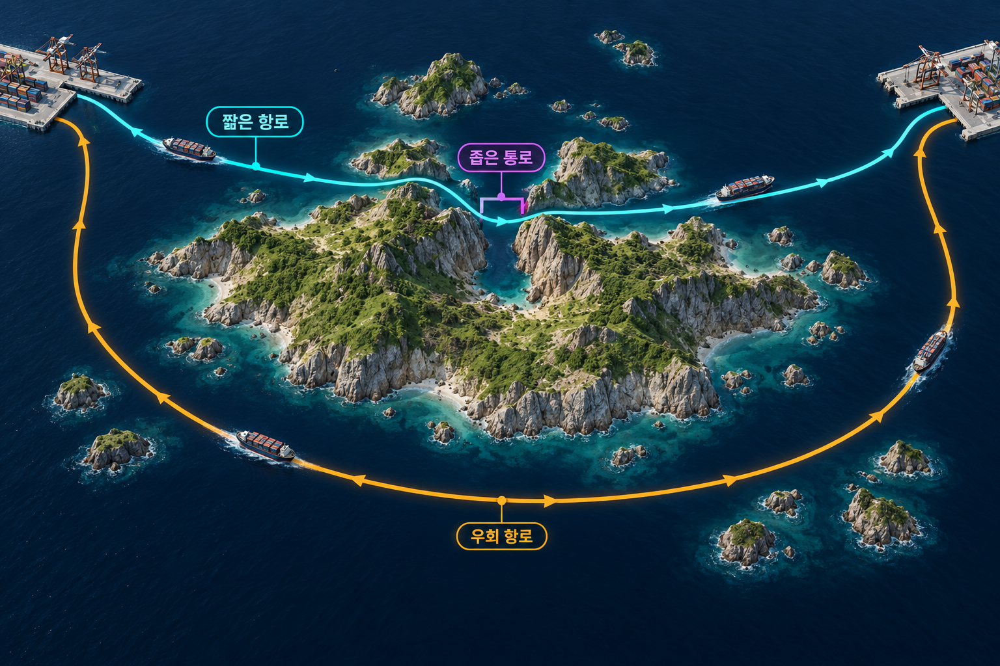

# 지정학

지리적 위치·지형·자원·교통망과 정치권력·대외전략의 관계를 연구하는 분야.

## 지리는 조건이지 단일한 원인이 아니다
같은 지형은 방어의 장벽이면서 교류의 장애가 될 수 있다. 평야는 자국의 통합과 적군의 진격을 모두 쉽게 만든다. 바다도 항해·보급 기술에 따라 장벽 또는 교통로로 작동한다. 따라서 지리의 효과는 기술·조직·정책과의 결합에서 해석한다.

지정학은 장기적인 전략의 제약과 기회를 설명하는 데 유용하지만, 정부의 모든 단기 결정을 지리로 환원할 수는 없다. 해양국가를 민주주의, 대륙국가를 권위주의와 자동으로 연결하는 것도 결정론이다.

## 국가유기체론과 팽창 논리
라첼과 셸렌 등 초기 논의는 국가를 환경 속에서 성장하는 유기체로 보았다. 독일 지정학의 생활공간·광역공간 논리는 이후 침략과 지배를 정당화하는 데 이용되었다. 국가의 생존에 공간이 필요하다는 설명에서 다른 공동체를 정복할 권리가 도출되지는 않는다.

## 해양력·하트랜드·림랜드
| 논자 | 전략적 초점 | 강조한 연결 |
| --- | --- | --- |
| 앨프리드 세이어 마한 | 해양력 | 상업·해운·해군·기지와 해상교통로 |
| 핼퍼드 매킨더 | 유라시아 중추지역 | 철도가 대륙의 자원·병력 동원을 바꾸는 효과 |
| 니컬러스 스파이크먼 | 유라시아 주변 연안인 림랜드 | 인구·산업·육상 및 해상 접근의 결합 |

매킨더의 1904년 논의는 지리 자체보다 교통기술의 변화가 해양과 대륙의 힘 관계를 바꿀 수 있다는 점에서도 중요하다.[^pivot] 세 관점을 ‘특정 땅이나 바다를 차지하면 무조건 세계를 지배한다’는 법칙으로 읽지 않는다.

## 교통로와 요충지
교통로는 상품·에너지·병력·정보가 이동하는 경로이며, 요충지 또는 초크포인트는 통행이 좁은 지점에 집중되는 곳이다. 해협·운하·항구의 차단은 연결망 전체의 비용을 높일 수 있다. 중요성은 지도상 위치뿐 아니라 대체 경로의 용량·시간·운송비로 평가한다.

일대일로는 이런 관점에서 육상·해상 인프라와 에너지 공급 경로의 다변화, 국내 지역개발, 대외 영향력의 확대를 함께 분석할 수 있다. 이를 특정 상대의 봉쇄에 대한 대응 하나로만 설명하면 목적의 다층성을 놓친다.

*좁은 통로의 중요성은 우회로가 있는지뿐 아니라 우회 시간·운송비·처리용량에 달려 있다. 실제 해안선이나 국가를 재현하지 않은 생성 그림이며 항로가 현재 폐쇄되었다는 뜻은 아니다.*

## 전략적 심도와 영향권
전략적 심도는 핵심 지역에 도달하기까지의 거리·장벽·후퇴 공간과 관련된다. 넓은 영토와 우호적 주변 지역은 방어에 유리할 수 있지만 긴 국경과 통합 비용도 만든다.

영향권은 강대국이 우월한 영향력을 행사하는 공간이다. 강대국이 주변국을 자국의 영향권으로 인식한다는 설명은 주변국의 주권을 제한할 정당한 권리가 있다는 주장과 다르다.

## 완충국과 분쇄지대
완충국은 경쟁하는 강대국 사이에서 직접 접촉을 줄이는 국가다. 독립을 유지하려면 자체 방어비용을 높이는 능력, 강대국들의 제한된 경쟁, 외부의 지원 등이 중요할 수 있다. 위치만으로 안전이 보장되지는 않는다.

분쇄지대는 내부 분열과 외부 세력 경쟁이 결합해 분쟁이 지속되는 지역을 설명하는 개념이다. 외세가 국내 세력을 지원하고 국내 세력이 외세를 끌어들이는 상호작용을 본다. 두 개념은 모든 약소국에 고정된 운명표가 아니다.

체커보드 모델도 인접한 적대국 너머의 국가와 협력하는 경향을 나타내는 단순 모형이다. 인접하면 반드시 적대한다거나 ‘적의 적’이 언제나 동맹이 된다는 보편 법칙은 아니다.

## 초크포인트와 대체 경로의 평가
가상의 해협이 막혔을 때 우회 항로가 있어도 항해일수·연료·보험료가 늘고 항만 처리능력이 부족할 수 있다. 물리적으로 지나갈 길이 있다는 사실과 기존 교역량을 같은 비용으로 유지할 수 있다는 사실은 다르다.

해저케이블·위성·데이터센터 같은 디지털 기반시설도 위치와 관할의 영향을 받는다. 다만 특정 거점을 통제하는 능력이 곧바로 모든 흐름을 차단할 능력은 아니다. 연결망의 중복성, 복구 시간, 민간 운영자와 국가의 권한을 함께 분석해야 한다.

## 지리 이론을 비교하는 세 질문
| 접근 | 중심 질문 | 함께 살필 변수 |
| --- | --- | --- |
| 마한의 해양력 | 바다는 방어 장벽이자 교역로인데, 누가 항로를 안전하게 이용할 수 있는가? | 상선, 함대, 항구, 보급기지와 생산 기반 |
| 매킨더의 하트랜드 | 철도 같은 육상교통이 대륙 내부의 이동과 자원 동원을 어떻게 바꾸는가? | 운송 기술, 거리, 생산지와 정치적 통제 |
| 스파이크먼의 림랜드 | 유라시아 연안부의 인구·산업·접근로가 대륙과 해양의 세력균형에 어떤 영향을 주는가? | 연안국의 동맹, 육상과 해상의 연결, 역외 세력의 개입비용 |

같은 지역도 운송 기술이나 대체 항로가 바뀌면 가치가 달라진다. 육로에 취약한 섬과 해상 수송에 의존하는 대륙국이 있을 수 있으므로, 해양국·대륙국을 해안선만으로 분류하면 실제 기회와 위협을 놓칠 수 있다.

## 완충·교량·관문의 역할
두 강대국 사이에서 직접 접촉을 줄이는 위치는 완충 역할에 해당한다. 주변의 충돌이 안으로 들어오고 내부의 분열이 외부 경쟁과 맞물리면 같은 지역이 분쇄지대가 될 수 있다. 교량은 다른 지역 사이의 거래와 조정을 돕는 역할을, 관문은 통과 경로나 기반시설을 관리하는 역할을 강조한다. 한 국가가 위치 덕분에 이런 기능을 맡을 기회는 있지만, 지속적인 자율성은 기반시설의 통제와 정치적 협상 능력에 좌우된다.

## 관련 문서
- [[balance-of-power|세력균형]] · [[interdependence|상호의존]]
- [[diplomacy#중견국과 연결 역할|외교 — 중견국과 연결 역할]]

## 출처

[^pivot]: [Mackinder — The Geographical Pivot of History（1904）](https://disp.web.uniroma1.it/sites/default/files/Mackinder_Geographical%2BPivot%2Bof%2BHistory.pdf). 원전에서 대륙 철도와 해양 이동의 상대적 효과를 확인할 수 있다.
