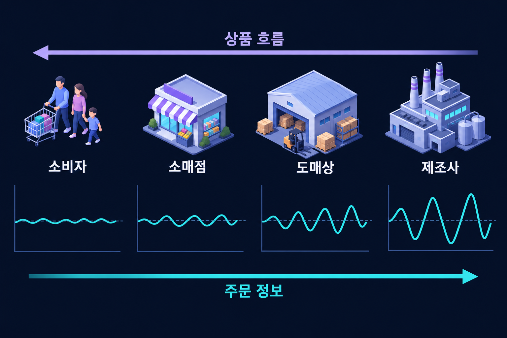

# 채찍효과

최종 소비의 작은 변동이 공급망 상류의 큰 주문 변동으로 증폭되는 현상.

{{틀:supply-chain-variability}}

## 정의
**채찍효과**(Bullwhip Effect)는 최종 수요보다 공급망 상류의 주문량 변동이 더 커지는 현상이다. 실제 소비의 변화와 중간 단계의 발주·재고 조정이 섞이면서 정보가 왜곡될 수 있다.

*소비의 작은 변동이 상류의 큰 발주 변동으로 증폭되는 모습을 단순화했다. 아래 곡선은 실제 관측자료가 아니며 평균 수요의 증가와 변동 폭의 확대를 구별해야 한다.*

## 주요 원인
수요 예측의 반복 수정, 묶음 주문, 가격할인에 맞춘 선구매, 공급 부족을 예상한 과잉주문과 취소 등이 변동을 키울 수 있다. 긴 리드타임과 정보 지연은 조정을 더 어렵게 만든다.

## 가상 예시
소매점의 소비가 10% 늘었지만 안전재고까지 채우려고 주문을 20% 늘릴 수 있다. 도매상도 이를 지속적인 증가로 해석해 더 크게 발주하면 생산자는 실제 소비보다 훨씬 큰 변동을 보게 된다.

## 결과와 대응
과잉재고·품절·급한 생산 변경·운송비 증가가 발생할 수 있다. 실제 판매정보의 공유, 주문주기의 안정화, 리드타임 단축, 판촉정책 조정과 협업이 대응 수단이다.

## 주의점
수요가 흔들린다는 사실만으로 채찍효과가 있다고 말할 수는 없다. 어느 단계의 어떤 데이터 변동을 비교했는지 확인해야 한다. 정보 공유만으로 모든 문제가 사라지지는 않으며 계약과 각 기업의 인센티브도 바뀌어야 할 수 있다.

## 판매 변동과 주문 변동을 비교하기
같은 기간·품목·시간 간격으로 최종 판매와 각 단계 주문을 맞춘 뒤 변동의 크기를 비교한다. 평균 규모가 다르면 분산의 숫자만으로 비교하기보다 정규화나 변동계수 등 지표 선택을 검토한다. 긴 집계주기는 단기 증폭을 가릴 수 있다.

안정적인 소비에도 월말 일괄 발주 때문에 주문이 출렁일 수 있다. 반대로 계절적인 판매 증가가 모든 단계에 비슷하게 전달되는 것만으로 증폭이 확인되는 것은 아니다. 판촉·묶음 주문·배급 규칙을 따로 확인해야 원인에 맞는 대책을 고를 수 있다.

## 관련 문서
- [[supply-chain|공급망관리]]
- [[incentives|인센티브]]
- [[business-analytics|비즈니스 애널리틱스]]

## 참고자료
- [Stanford GSB — 채찍효과 연구](https://www.gsb.stanford.edu/faculty-research/publications/information-distortion-supply-chain-bullwhip-effect)
