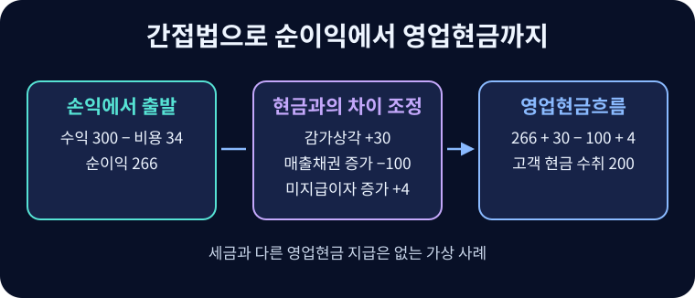

# 현금흐름표

현금및현금성자산의 변동을 영업·투자·재무활동으로 나누고 이익이 현금으로 전환되는 과정을 보여 주는 재무제표.

## 세 활동과 현금의 범위

현금성자산은 단기에 확정 금액으로 전환하기 쉽고 가치변동 위험이 작으며 단기 현금지급을 위해 보유하는 투자다. 보통 취득일로부터 만기가 3개월 이내인 경우를 검토한다.

과거 자금변동표는 자금의 범위를 운전자본 등으로 잡기도 했다. 운전자본이 늘어도 채권을 회수하지 못했다면 당장 사용할 현금은 부족할 수 있다. 현금흐름표는 현금과 현금성자산의 변화에 초점을 맞춘다. 영업은 매입·생산에서 판매와 회수까지, 투자는 자산의 취득에서 사용과 처분까지, 재무는 투자자·채권자에게 조달하고 상환·배분하기까지의 흐름과 연결된다.

| 활동 | 무엇을 보여 주는가 | 예 |
| --- | --- | --- |
| 영업(CFO 또는 OCF) | 주된 수익 창출 활동과 투자·재무로 분류되지 않는 활동 | 고객 대금 수취, 공급업체·종업원 지급 |
| 투자(CFI) | 장기자산과 현금성자산에 해당하지 않는 투자자산의 취득·처분 | 설비 취득과 매각, 사업 인수·처분 |
| 재무(CFF) | 납입자본과 차입의 규모·구성 변화 | 주식 발행, 차입과 원금 상환, 자기주식 취득 |

$$C_{\mathrm{end}}=C_{\mathrm{begin}}+CFO+CFI+CFF+FX$$

$C_{\mathrm{begin}}$과 $C_{\mathrm{end}}$는 기초·기말 현금및현금성자산, $FX$는 외화 현금 잔액에 대한 환율변동 효과다. 환율변동 효과를 별도 표시해야 세 활동의 합과 실제 기말 잔액을 연결할 수 있다. 현금이 오가지 않는 리스 개시, 현물출자, 채무의 출자전환은 세 활동의 현금흐름에서 빼고 필요한 정보를 따로 공시한다. 이자·배당 및 법인세의 분류는 적용 기준, 보고기간 및 사업 특성을 확인한다.

## 직접법과 간접법

직접법은 주요 현금 수취·지급을 총액으로 보여 준다. 매출 300 중 외상매출이 100이고 기초 채권이나 다른 변동이 없다면 고객 수취액은 200이다. 간접법은 손익에서 시작해 현금이 움직이지 않은 손익, 수익·비용과 수취·지급 시점 차이, 투자·재무활동에 속하는 손익을 조정한다. 두 방법으로 계산한 영업활동현금흐름은 같아야 한다. IAS 7은 직접법 사용을 권장하며, IFRS 18 적용 시 개정 IAS 7은 간접법의 출발점을 영업손익으로 정한다.

현금 변동은 회계방정식에서도 유도할 수 있다. 자산을 현금과 나머지 자산 $A_{\mathrm{other}}$로 나누면 $C+A_{\mathrm{other}}=L+E$다. 따라서 기말과 기초의 차이는 $\Delta C=\Delta L+\Delta E-\Delta A_{\mathrm{other}}$다. $C$는 현금및현금성자산, $L$은 부채, $E$는 자본이다. 여기에서 부채와 자본의 변화를 이익, 주주거래, 차입·상환 등으로 쪼갠다. 잔액 차이에는 현금이 움직이지 않은 변동도 있으므로 계정별 변동 원인을 찾아야 세 활동별 현금흐름을 구할 수 있다.

$$CFO=NI+D+N-\Delta OA+\Delta OL+R$$

위 식은 순이익에서 출발하는 단순 예다. $NI$는 당기순이익, $D$는 감가상각·상각, $N$은 다른 비현금 손익의 순조정액, $OA$와 $OL$은 각각 영업 관련 비현금 운전자산·운전부채, $\Delta X=X_{\mathrm{end}}-X_{\mathrm{begin}}$이다. $R$은 처분손익이나 분류 차이를 조정한 순액이다. 계정 변화에서 사업결합, 환산, 상각·제각 등 이미 다른 항목에 반영한 변동을 분리해 중복을 피한다.

| 변동 | 간접법 조정 | 이유 |
| --- | --- | --- |
| 매출채권 증가 | 차감 | 인식한 매출 중 미회수액 |
| 재고 증가 | 차감 | 당기 비용화된 금액보다 더 많이 재고에 투입 |
| 선급비용 증가 | 차감 | 아직 비용이 되지 않은 선지급 |
| 매입채무·미지급비용 증가 | 가산 | 비용 또는 매입 중 아직 지급하지 않은 부분 |
| 계약부채 증가 | 가산 | 당기 수익 인식액보다 먼저 받은 금액 등이 늘어남 |
| 감가상각·손상차손 | 통상 가산 | 손익은 줄지만 해당 비용 인식 자체에는 현금 유출이 없음 |
| 유형자산 처분이익 | 차감 | 처분대금 전체를 투자활동에서 별도 보고 |

주식기준보상, 미실현 평가손익, 미실현 환차이, 지분법손익, 충당부채도 조정 대상이 될 수 있다. 예를 들어 충당부채 인식으로 순이익이 감소했으면 비현금 인식액을 되돌리고 실제 지급이 속한 활동을 반영한다. 지분법이익을 되돌리는 것과 투자에서 받은 실제 배당을 보고하는 것은 별도다.

[[double-entry-bookkeeping#수리점의 첫 달|수리점 사례]]에서 순이익 266에는 장비 감가상각 30과 아직 내지 않은 이자 4가 비용으로 들어 있고, 받지 않은 외상매출 100도 수익으로 들어 있다. 세 항목을 조정하면 $266+30-100+4=200$이다. 직접법으로 보면 당기에 고객이 낸 현금 200만 영업에 남는다. 이자는 실제 지급이 없으므로 이 사례의 영업·재무활동 어디에도 현금 지급으로 나타나지 않는다.[^interest-bridge]

## T계정으로 역산하기

차변·대변에 기초 잔액, 기말 잔액, 손익·주석으로 확인한 변동을 넣고 미지의 현금 거래를 푼다. 매출채권 T계정에서 기초와 외상매출을 더하고 제각·기말을 빼면 다른 변동이 없을 때 고객 회수액이 나온다. 유형자산의 경우 단순한 원가모형에서 다음 두 식을 사용한다.

$$PPE_{\mathrm{end}}=PPE_{\mathrm{begin}}+I-D-B,\qquad S=B+G$$

$PPE$는 순장부액, $I$는 취득액, $D$는 감가상각비, $B$는 처분한 자산의 순장부액, $S$는 처분대금, $G$는 처분손익이다. 장부액이 100에서 120, 감가상각이 15, 처분 장부액이 10이면 취득액은 $120-100+15+10=45$다. 처분이익이 3이면 매각대금은 13이다. 전액 현금이고 다른 취득·손상·환율·재평가 등이 없다면 CFI는 $13-45=-32$다. 감가상각 15와 처분이익 3은 각각 간접법에서 가산·차감한다.

차입금 잔액은 기초 잔액에 신규 차입을 더하고 상환을 뺀 뒤 환율변동·출자전환·유효이자 상각을 구분한다. 배당 지급액은 선언액과 미지급배당의 기초·기말 차이로 확인한다. 리스 원금 상환은 재무활동이며 개시 시 인식한 리스부채 증가 전부를 차입 현금유입으로 보지 않는다.

기초와 기말만으로 부족한 경우에는 원장과 자산·부채의 주석을 함께 쓴다. 예컨대 매입채무 기초가 20, 당기 외상매입이 90, 기말이 30이면 다른 변동이 없을 때 실제 지급액은 $20+90-30=80$이다. 부채 증가 10을 간접법에서 가산하는 이유와 직접법의 지급액 80이 같은 계정 흐름에서 나온다는 점을 확인할 수 있다.

## 현금흐름의 질

EBITDA는 이자·세금·감가상각·상각 전 이익을 뜻한다. 운전자본 투입, 현금 세금·이자, 자본적 지출을 그대로 보여 주지 않는다. $CFO/EBITDA$는 회계상 영업 성과의 현금 전환을 보는 보조지표다. EBITDA가 0에 가깝거나 음수면 비율이 불안정하다. 분자·분모가 양수이고 기간·범위가 일치하면 $EV/CFO=(EV/EBITDA)/(CFO/EBITDA)$로 연결된다. 예를 들어 $EV/EBITDA=8$, 현금 전환율 50%면 $EV/CFO=16$이다. CFO에 이자 지급이 포함될 수 있으므로 이 배수를 기업가치 평가에 사용할 때 자금 제공자 범위를 확인한다.

단순 자유현금흐름은 $FCF=CFO-CapEx$로 본다. $CapEx$는 현금으로 지출한 자본적 지출이다. 기업 전체에 귀속되는 FCFF와 정의가 다를 수 있다. 소유주 이익(Owner Earnings)은 비현금 비용을 조정한 이익에서 경쟁력 유지에 필요한 자본적 지출과 추가 운전자본을 차감하는 추정 개념이다. 유지투자와 성장투자의 분리는 판단을 요구한다.

개발비 자산화로 연구개발 지출 중 일부가 CFI로 분류되면 비용처리 기업보다 당기 손익과 CFO가 높아질 수 있다. 비교용 조정 CFO는 보고 CFO에서 해당 자산화 현금지출을 뺀다. 지급 지연, 채권 조기 회수·유동화, 공급망금융, 영업 유출의 투자활동 분류도 CFO를 높여 보이게 할 수 있다. 매출과 채권의 성장, 채권 연령, 지급일수, 후속 기간 반전, 금융부채 변동 조정표를 대조한다. $NI-CFO$는 간편한 발생액 지표이며 세금·이자 등 분류 차이가 포함될 수 있다.

## 기업 생애주기와 사업모형

| 전형적 국면 | 영업 | 투자 | 재무 |
| --- | --- | --- | --- |
| 도입 | − | − | + |
| 성장 | + | − | + |
| 성숙 | + | − | − |
| 쇠퇴 | ± | + | ± |

부호는 관찰의 출발점이다. 성숙기업은 영업에서 조달해 설비를 유지하고 배당·상환할 수 있다. 쇠퇴기의 투자 순유입은 자산 매각에서 생길 수 있다. 구독과 소매는 고객 선결제 또는 빠른 현금 판매로 운전자본이 유리할 수 있고, 제조업은 재고와 설비에 많은 현금이 묶인다. 금융업은 금융자산·부채의 성격부터 다르다. 한 해의 부호나 비율만으로 국면과 이익의 질을 확정하기 어렵다.

## 관련 문서

- [[financial-statements|재무제표]]
- [[double-entry-bookkeeping|복식부기]]
- [[working-capital|운전자본]]
- [[earnings-quality|이익의 질]]
- [[business-valuation|기업가치평가]]

## 참고자료

- [IFRS Foundation — IAS 7 현금흐름표](https://www.ifrs.org/issued-standards/list-of-standards/ias-7-statement-of-cash-flows/)
- [IFRS Foundation — IFRS 18 재무제표 표시와 공시](https://www.ifrs.org/issued-standards/list-of-standards/ifrs-18-presentation-and-disclosure-in-financial-statements/)

[^interest-bridge]: 순이익에서 출발하고 해당 이자 비용이 영업현금흐름에 대응한다고 놓으면 미지급이자의 증가를 가산한다. 이자 현금흐름을 재무활동에 분류한다면 순이익에서 차감된 이자비용을 되돌리고 같은 미지급이자 증가를 다시 더하지 않는다. 영업손익에서 시작해 이자비용이 이미 제외된 경우에도 조정 여부가 달라진다.
