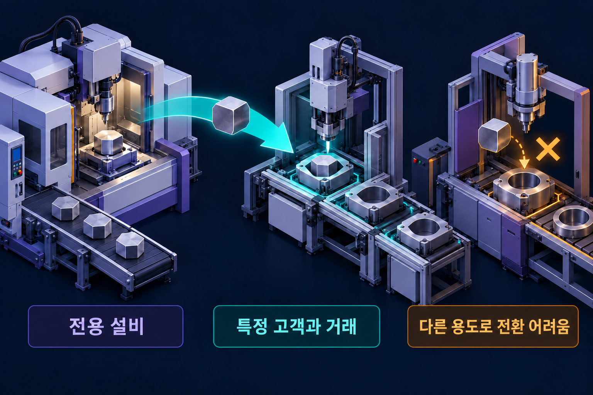

# 홀드업 문제

특정 거래관계에 묶인 투자가 사후 협상에서 취약성을 만드는 현상.

## 자산특수성
**자산특수성**(Asset Specificity)은 어떤 자산이 특정 관계에서는 가치가 높지만 다른 용도로 옮기면 가치가 크게 줄어드는 성질이다. 전용 설비뿐 아니라 위치·인적 숙련·고객 맞춤 절차에도 나타날 수 있다.

*같은 설비·숙련·부품이 현재 거래에서와 다른 용도에서 서로 다른 가치를 가질 수 있다. 규격 차이는 자산특수성을 설명하는 가상 예시이며 실제 전환비용을 수치로 측정한 그림은 아니다.*

## 홀드업의 구조
공급자가 특정 고객만을 위한 설비에 투자한 뒤 고객이 가격을 크게 낮추라고 요구하면, 공급자는 다른 거래로 옮기기 어렵다. 이처럼 관계에 묶인 투자 이후 상대가 약점을 이용해 거래조건을 바꾸려는 문제가 **홀드업**(Hold-up)이다.

공급자 역시 납기나 추가 부품을 통제해 구매자를 압박할 수 있다. 따라서 어느 쪽만의 문제라고 고정할 수 없다.

## 불완전계약과 투자 위축
미래의 모든 상황을 계약에 미리 적기 어렵다. 사후의 협상 가능성을 예상하면 원래 유익한 투자도 덜 하게 될 수 있다. 이미 지출된 매몰비용과 재배치에 따른 가치 감소를 구분하면 위험의 원인이 명확해진다.

## 대응
장기계약, 최소구매 약정, 공동투자, 상호 의존적 투자, 신뢰관계, 수직적 통합 등을 검토한다. 내부화는 협상 문제를 줄일 수 있지만 관료비용을 늘리므로 자산특수성이 높다는 이유만으로 언제나 인수가 최적이라는 결론은 나오지 않는다.

## 관계특수적 준지대의 예
전용 설비가 현재 거래에서는 100의 가치를 내지만 다른 거래로 옮기면 30밖에 얻지 못한다면 차이인 70이 관계를 유지할 때 생기는 추가 몫이다. 투자 뒤에는 이 몫을 누가 가져갈지를 둘러싼 재협상 유인이 생길 수 있다. 이 수치는 개념을 설명하는 가상의 가치 비교다.

공급자가 사후에 성과의 작은 몫만 받을 것으로 예상하면 사회적으로 유익한 투자도 줄일 수 있다. 사후 거래가 효율적으로 성사되었다고 사전 투자까지 효율적이었다고 볼 수 없는 이유다. 투자비 회수와 대체 용도의 가치, 사후 협상 규칙을 함께 확인한다.

## 관련 문서
- [[transaction-costs|거래비용]]
- [[bounded-rationality|제한된 합리성]] · [[incomplete-contracts|불완전계약]]
- [[supply-chain|공급망관리]]

## 참고자료
- [노벨위원회 — 경제적 거버넌스 연구 배경](https://www.nobelprize.org/uploads/2018/06/advanced-economicsciences2009.pdf)
