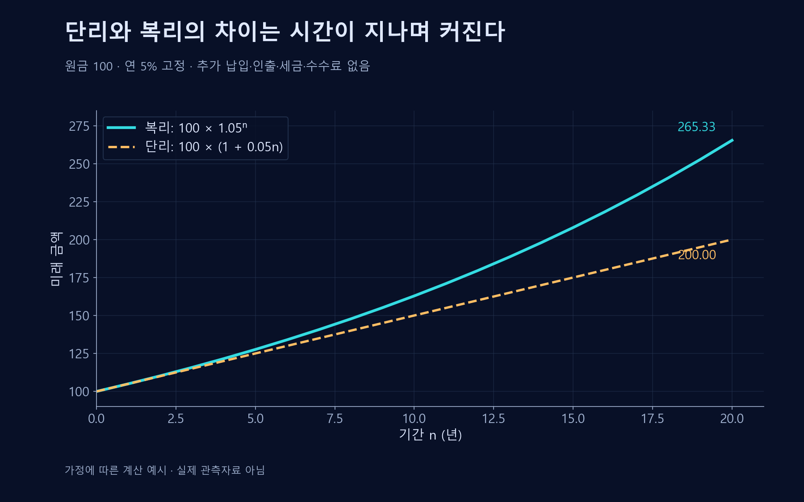

# 화폐의 시간가치

수익의 재투자와 현재가치 계산으로 시간에 따른 금액을 비교하는 원리.

{{틀:investment-value}}

## 복리
**복리**(Compounding)는 원금뿐 아니라 이전 기간에 발생한 수익도 다음 기간 수익의 기준에 포함되는 구조다. 일정 수익률을 가정하면 다음과 같다.
$$FV=PV(1+r)^n$$
$PV$는 현재 금액, $FV$는 미래 금액, $r$은 기간당 수익률, $n$은 기간 수다.

## 현재가치
미래 금액을 현재와 비교하려면 할인한다.
$$PV=\frac{FV}{(1+r)^n}$$
할인율은 시간과 기회비용, 위험에 대한 가정을 반영한다. 모든 상황에 같은 할인율을 적용할 수는 없다.

## 계산 예시
설명을 위한 가정으로 원금 100에 연 5%가 2년간 적용되고 수익을 모두 재투자하면 $100\times1.05^2=110.25$다. 매년 같은 이자가 보장된다는 실제 투자 예측이 아니다.

## 단리와 복리의 비교

단리는 매년 최초 원금에 같은 이자를 더하고, 복리는 이전 수익도 다음 기간의 기준에 포함한다. 가상의 고정 금리에서 20년 뒤 금액은 각각 200과 약 265.33이다. 추가 납입·인출·세금·수수료는 생략했으며 실제 투자 성과를 예측하는 그래프가 아니다.

## 수익률이 변할 때
$$FV=PV\prod_{t=1}^{n}(1+r_t)$$
변동수익률의 단순 산술평균만으로 복리 결과를 계산하면 틀릴 수 있다. 10% 상승 뒤 10% 하락한 자산은 원래 금액으로 돌아오지 않는다.

## 실질 금액
수수료·세금·물가상승은 실제 구매력을 바꾼다. 명목금액의 증가와 실질적인 부의 증가를 구분해야 한다. 복리는 손실이나 부채에도 작용하므로 무조건적인 자산증식 장치로 해석하면 안 된다.

## 복리와 할인식의 유도
시점 $t$의 금액을 $V_t$라 하고 추가 납입·인출이 없으면 $V_{t+1}=V_t(1+r)$다. $V_0=PV$에서 반복하면 $V_1=PV(1+r)$, $V_2=PV(1+r)^2$이고 귀납적으로 $V_n=FV=PV(1+r)^n$을 얻는다. $r>-1$에서 양의 $(1+r)^n$으로 나누면 현재가치 식이다.

변동수익률 식에서 $r_t$는 $t$번째 기간 수익률, $t$는 기간 번호, $\prod$는 모든 기간의 배율을 곱한다는 뜻이다. 10% 상승 뒤 10% 하락이면 $1.1\times0.9=0.99$이므로 누적수익률은 −1%다. 평균 수익률이 0%여도 원금을 회복하지 못한다.

## 여러 현금흐름의 현재가치
시점 $t$에 받을 금액을 $CF_t$, 마지막 수취 시점을 $T$라 하면 일정 할인율 아래 현재가치는 다음과 같다.

$$PV=\sum_{t=1}^{T}\frac{CF_t}{(1+r)^t}$$

각 현금흐름을 동일한 시점으로 옮겨 합한 결과다. 연 수익률과 월 단위 현금흐름을 섞지 말고, 위험한 현금흐름에는 위험을 반영하는 방식도 맞춰야 한다. 확정 금액의 단순 복리 계산과 불확실한 투자의 가치평가는 가정이 다르다.

## 관련 문서
- [[risk-return|투자]] · [[diversification-investing|분산 투자]]
- [[consumption-smoothing|소비 평활화]]
- [[capital-structure|자본구조]]

## 참고자료
- [SEC Investor.gov — 투자 기본 개념](https://www.investor.gov/introduction-investing)
