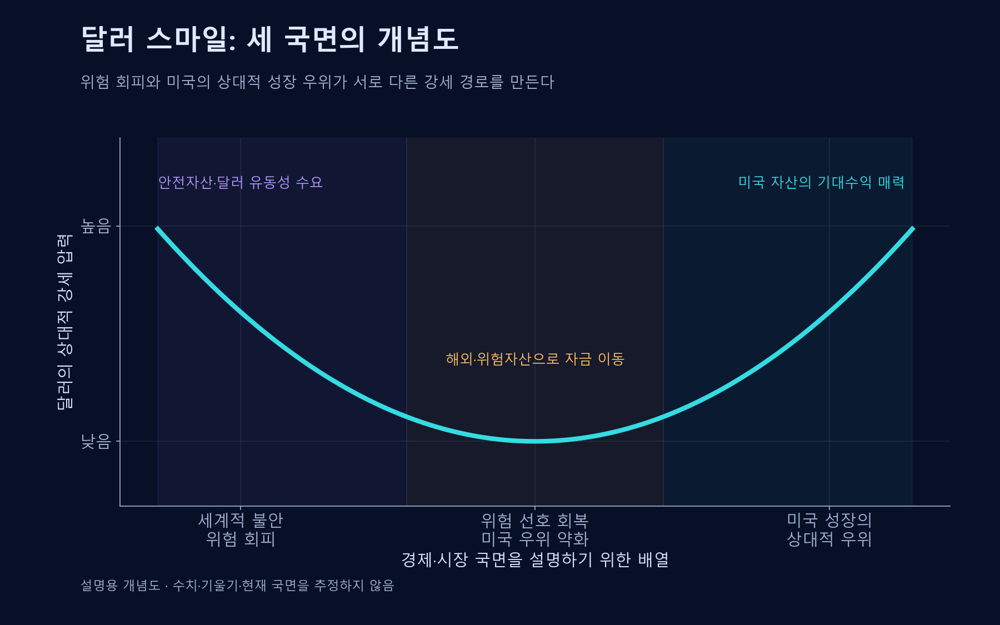

# 환율

통화 간 교환가격의 변화가 거래·자산·경쟁력에 미치는 영향.

## 환율의 표시
**환율**(Exchange Rate)은 두 통화의 교환가격이다. 원/달러 환율을 1달러당 원화 금액으로 표시하면 그 수치의 상승은 원화 가치 하락을 뜻한다. 어느 통화를 분자와 분모에 두었는지 먼저 확인해야 한다.

## 명목·실질환율
명목환율은 통화의 교환비율이고, 실질환율은 상대적인 물가를 반영해 상품의 교환조건을 보려는 지표다. 여러 상대국을 묶은 실효환율은 한 통화쌍의 환율과 다르다.

## 결정 요인
변동환율에서는 무역·자본흐름·금리 기대·위험 인식 등이 통화의 수요·공급과 연결된다. 고정 또는 관리된 환율제도에서는 정책의 역할이 다르다. 한 요인만으로 단기 환율을 확실하게 예측하기 어렵다.

## 달러 스마일 커브
**달러 스마일**은 스티븐 리 젠과 파티흐 일마즈가 제시한 가설로, 달러 강세가 서로 다른 두 경로에서 나타날 수 있음을 설명한다. 세계적 불안에서는 안전자산·달러 유동성 수요가, 미국의 상대적 성장 우위에서는 미국 자산에 대한 자금 유입이 중요해질 수 있다.[^dollar-smile]

| 국면 | 강조하는 경로 |
| --- | --- |
| 세계적 불안·위험 회피 | 안전자산이나 결제·상환에 필요한 달러 수요가 커질 수 있다. |
| 위험 선호 회복·미국 우위 약화 | 미국 밖의 자산으로 자금이 이동하며 달러 강세 압력이 낮아질 수 있다. |
| 미국의 상대적 성장 우위 | 성장·수익·금리 기대가 미국 자산의 매력을 높일 수 있다. |

가로축은 국면을 비교하기 위한 배열이며 시간이나 실측 성장률의 눈금이 아니다. 세로축에도 실측 환율이나 달러지수 값을 부여하지 않았다. 따라서 곡선에서 현재 위치·전환 시점·목표 환율을 계산할 수 없다.

위험 회피가 언제나 달러 강세로 이어지는 것도 아니다. 충격의 원인이 미국 자체인지, 달러 조달이 얼마나 긴박한지, 다른 안전자산에 대한 선호가 어떤지에 따라 반응이 달라질 수 있다.[^dollar-haven] 기업의 부가가치 분포를 그리는 [[smile-curve|가치사슬의 스마일 커브]]와는 다른 개념이다.

## 가상 예시
달러로 매출을 받고 원화로 비용을 내는 기업은 달러 가치가 오르면 원화 환산 매출이 늘 수 있다. 하지만 원재료도 달러로 사거나 부채가 달러 표시라면 효과가 달라진다. 수출기업이면 언제나 환율 상승의 이익을 얻는다는 식으로 일반화하면 안 된다.

## 위험 관리
거래 통화와 시점을 맞추거나 생산·조달의 통화 구조를 조정하고 선도·선물 등으로 일부 노출을 관리할 수 있다. 계약의 현금흐름과 장기 경쟁력에 대한 영향을 구분해야 한다.

## 거래·환산·경제적 노출
거래 노출은 이미 약정한 외화 현금흐름의 가치 변화, 환산 노출은 해외 사업의 재무정보를 보고통화로 바꾸는 영향, 경제적 노출은 장기 경쟁력과 미래 현금흐름의 변화를 가리킨다. 장부의 환산손익과 실제 외화 지급 부담은 같은 현상이 아니다.

달러 100을 받을 기업이 1달러당 1,300원으로 환산하면 13만 원, 1,200원으로 환산하면 12만 원이다. 이는 다른 조건을 고정한 계산이며 외화 비용·부채·가격 조정은 생략했다. 환율 변화의 방향을 말할 때는 어떤 통화의 관점인지 밝혀야 한다.

## 관련 문서
- [[hedging|헤지]]
- [[current-account|경상수지]]

## 참고자료
- [호주중앙은행 — 환율과 측정](https://www.rba.gov.au/education/resources/explainers/exchange-rates-and-their-measurement.html)

[^dollar-smile]: [Eurizon SLJ Capital — The Dollar Smile](https://eurizonsljcapital.com/dollar-smile/). 제안자들이 설명한 세 국면을 참고해 별도로 그린 개념도이며 원자료의 실측 그래프를 복제한 것이 아니다.
[^dollar-haven]: [호주중앙은행 — On the Safe-haven Status of the US Dollar, 2026-03-07](https://www.rba.gov.au/speeches/2026/sp-dg-2026-03-07.html). 충격의 종류에 따라 달러의 안전자산 반응이 달라질 수 있음을 논의한다.
